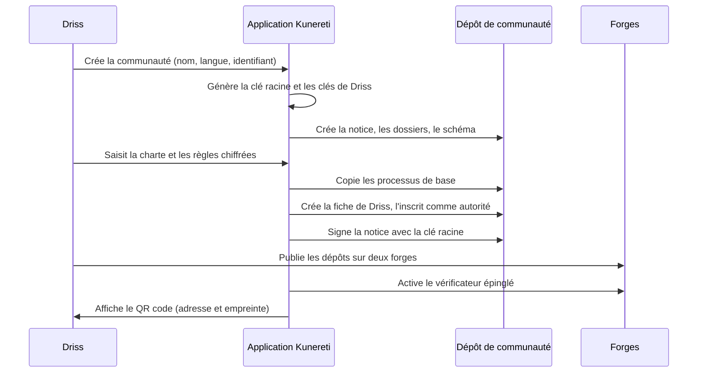

# **Fonder une communauté**

## Résumé
Driss fonde la communauté de la Coopérative des Tilleuls. Il crée le dépôt de communauté, y dépose la charte et les processus de base, génère la clé racine, publie le dépôt sur deux forges et obtient le QR code qui permettra aux autres de rejoindre la communauté.

## Acteurs en jeu
- **Driss** : le fondateur, première autorité de la communauté.
- **Application Kunereti** (ligne de commande ou poste de travail) : crée les fichiers, les clés et les signatures.
- **Forges** : les deux hébergements Git où le dépôt est publié.

## Prérequis
- Driss a installé Kunereti sur son poste.
- Il dispose d'un compte sur deux forges Git distinctes.
- La coopérative a arrêté le texte de sa charte et ses règles chiffrées (taille des groupes, durée des itérations, quorums, nombre de jetons).

## Étapes du scénario
1. Driss lance la création d'une communauté et saisit son nom, sa langue et son identifiant court (`tilleuls`).
2. L'application génère la clé racine de la communauté et la paire de clés personnelle de Driss (signature et chiffrement).
3. Elle crée le dépôt `tilleuls--community` avec sa notice `_Community.md`, les dossiers `members/`, `authorities/`, `groups/`, `ballots/`, `supports/`, `messages/`, `workflows/` et `agents/`, le schéma et le manifeste des scripts de vérification.
4. Driss colle la charte et renseigne les règles chiffrées : douze participants par groupe, cinq groupes par membre, sept jetons, jugement majoritaire à sept mentions.
5. L'application copie les définitions de processus de base, crée la fiche de membre de Driss, l'inscrit comme autorité et signe la notice avec la clé racine.
6. Elle crée de la même façon le dépôt d'idées `tilleuls--ideas`, recensé dans la notice.
7. Driss publie les deux dépôts sur les deux forges ; l'application y active le vérificateur épinglé, hébergé hors des dépôts.
8. L'application affiche le QR code : l'adresse du dépôt de communauté et l'empreinte de la clé racine. Driss l'imprime et le diffuse.

## Diagramme de séquence Mermaid

Ce diagramme montre qu'une communauté n'est rien d'autre qu'un dépôt signé et son QR code. Driss en est le premier greffier, pas le propriétaire des décisions : dès qu'il y aura d'autres membres, les autorités seront désignées par scrutin (scénario 6).

Cas d'utilisation : « Faire vivre la communauté ». Retour à l'analyse : [[KR Analyse]].
