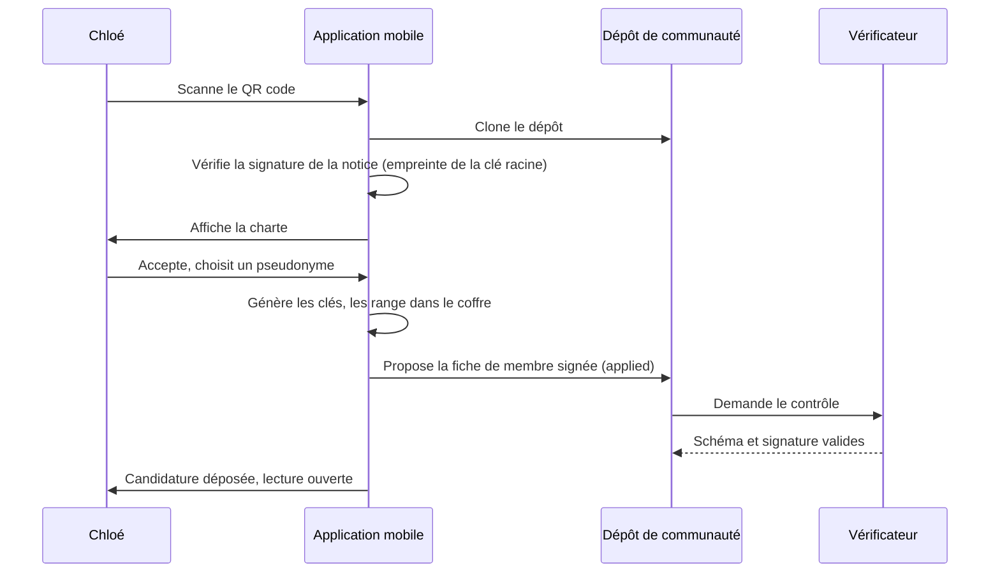

# **Rejoindre une communauté**

## Résumé
Chloé a reçu le QR code de la Coopérative des Tilleuls. Elle le scanne avec l'application mobile, qui clone le dépôt de communauté, vérifie l'empreinte de la clé racine, crée ses clés et dépose sa candidature. Chloé peut lire tout de suite ; elle ne pourra écrire qu'une fois admise.

## Acteurs en jeu
- **Chloé** : la candidate.
- **Application mobile** : cache entièrement Git et les clés.
- **Dépôt de communauté** : reçoit la candidature.

## Prérequis
- Chloé a installé l'application Kunereti sur son téléphone.
- Elle dispose du QR code de la communauté (affiche, courriel, écran d'un membre).
- La communauté accepte les candidatures (règle de la charte).

## Étapes du scénario
1. Chloé ouvre l'application et choisit « Rejoindre une communauté ».
2. Elle scanne le QR code. L'application y lit l'adresse du dépôt et l'empreinte de la clé racine.
3. L'application clone le dépôt de communauté et vérifie que la notice est bien signée par la clé dont l'empreinte figure dans le QR code. Si ce n'est pas le cas, elle s'arrête et le dit.
4. Chloé lit la charte et l'accepte.
5. Elle choisit un pseudonyme. L'application génère ses deux paires de clés et les range dans le coffre du téléphone ; elle lui fait noter une phrase de secours.
6. L'application crée la fiche de membre de Chloé (pseudonyme et clés publiques, aucune donnée d'identité), à l'état `applied`, la signe et la propose au dépôt de communauté par une demande de fusion.
7. Le vérificateur contrôle le schéma et la signature ; la candidature est fusionnée.
8. L'application affiche « Candidature déposée, en attente de vérification » et ouvre l'accueil en lecture seule.

## Diagramme de séquence Mermaid

Ce diagramme illustre le remplacement de l'installation et de l'inscription de 2017 par un seul geste : scanner, cloner, vérifier. La communauté ne reçoit qu'un pseudonyme et des clés publiques. La suite, l'admission par les pairs, fait l'objet du scénario 3.

Cas d'utilisation : « Faire vivre la communauté ». Retour à l'analyse : [[KR Analyse]].
