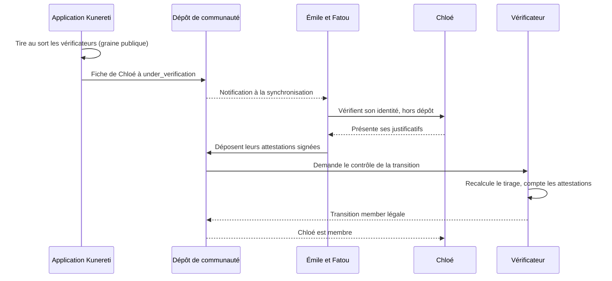

# **Admettre un candidat**

## Résumé
La candidature de Chloé déclenche le processus de citoyenneté hérité de KuneAgi. Des vérificateurs sont tirés au sort parmi les membres ; ils s'assurent, hors des dépôts, que Chloé est une personne réelle et qu'elle n'a pas déjà un compte, puis signent une attestation. Quand assez d'attestations sont réunies, Chloé devient membre.

## Acteurs en jeu
- **Émile et Fatou** : membres tirés au sort comme vérificateurs.
- **Chloé** : la candidate.
- **Application Kunereti** : effectue le tirage et contrôle les signatures.
- **Dépôt de communauté** : porte la fiche de Chloé et les attestations.

## Prérequis
- La fiche de Chloé est à l'état `applied` (scénario 2).
- La charte fixe le nombre de vérificateurs (trois par défaut, comme dans KuneAgi) et la durée de la vérification.
- Une graine publique imprévisible est disponible pour le tirage (balise aléatoire publique ou engagements croisés de plusieurs membres).
- La communauté compte assez de membres pour le tirage ; en deçà, c'est le fondateur qui vérifie.

## Étapes du scénario
1. L'application de n'importe quel membre calcule le tirage : le rang de chaque membre est l'empreinte de la graine et de son identifiant ; les premiers sont désignés. Le résultat est le même sur tous les appareils.
2. La fiche de Chloé passe à l'état `under_verification` ; Émile et Fatou sont notifiés à leur prochaine synchronisation, et relancés avant l'échéance.
3. Chloé choisit la forme de la vérification : une visioconférence, pour laquelle elle propose trois créneaux, ou la copie d'une pièce d'identité dont elle masque ce qui n'est pas utile, envoyée séparément à chaque vérificateur par un canal extérieur aux dépôts.
4. Chaque vérificateur confronte ce qu'il voit à ce que Chloé déclare, et s'assure autant qu'il le peut qu'elle n'a pas déjà un compte. Au moindre doute, il refuse.
5. Il détruit la copie reçue et en informe Chloé. Il signe un avis, favorable ou défavorable, qui dit « j'ai vérifié » sans rien consigner de ce qu'il a vu, et le dépose dans le dépôt de communauté.
6. La vérification se clôt quand tous ont répondu, ou à l'échéance. Chloé est admise si la majorité des avis exprimés est favorable ; si personne ne s'est prononcé, elle est refusée.
7. La transition `under_verification → member` est alors légale ; le vérificateur de la forge recalcule le tirage et recompte les avis avant qu'une autorité la fusionne.
8. Chloé est membre : elle reçoit ses sept jetons et peut contribuer, discuter, voter. Refusée, elle en est informée et peut déposer une nouvelle candidature.

## Diagramme de séquence Mermaid

Ce diagramme montre comment la communauté se protège des comptes multiples sans conserver aucune donnée d'identité : la vérification a lieu entre personnes, et le dépôt n'en garde que des attestations signées par des membres que personne n'a choisis. Les règles de majorité et de silence sont celles de KuneAgi. Deux points restent à trancher : la preuve qu'un candidat n'a pas déjà un compte, que KuneAgi tirait d'un registre d'identités que Kunereti refuse de tenir, et l'anonymat des vérificateurs, que des avis signés ne garantissent pas. La règle a d'ailleurs changé de sens avec le temps : les spécifications de 2011 prévoyaient cinq vérificateurs, dix jours pour transmettre ses justificatifs puis dix jours pour se prononcer, et tenaient le silence d'un vérificateur pour un accord ; à partir de 2016, ils sont trois et le silence vaut refus.

Cas d'utilisation : « Faire vivre la communauté ». Retour à l'analyse : [[KR Analyse]].
