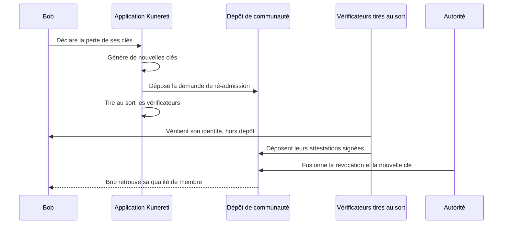

# **Retrouver sa qualité de membre après la perte de ses clés**

## Résumé
Bob a perdu son téléphone et n'a pas conservé sa phrase de secours. Il n'existe pas de guichet « mot de passe oublié » : la communauté le réadmet comme elle l'avait admis, par ses pairs. Son ancienne clé est révoquée, une nouvelle est rattachée à sa fiche, et son historique reste le sien.

## Acteurs en jeu
- **Bob** : le membre qui a perdu ses clés.
- **Vérificateurs tirés au sort** : attestent que le demandeur est bien Bob.
- **Autorité** : fusionne la révocation une fois celle-ci légale.
- **Dépôt de communauté** : porte la fiche de Bob.

## Prérequis
- Bob est membre de la communauté.
- Il ne dispose plus ni de sa clé de signature ni de sa phrase de secours.
- La charte décrit la procédure de ré-admission.

## Étapes du scénario
1. Bob installe l'application sur un nouvel appareil, scanne le QR code et déclare « J'ai perdu mes clés » en indiquant son pseudonyme.
2. L'application génère de nouvelles clés et dépose une demande de ré-admission signée avec la nouvelle clé, qui cite la fiche de Bob.
3. Des vérificateurs sont tirés au sort, comme pour une admission (scénario 3).
4. Ils vérifient hors dépôt que le demandeur est bien la personne admise sous ce pseudonyme, puis signent leurs attestations.
5. Quand le nombre exigé est atteint, la fiche de Bob est mise à jour : l'ancienne clé est marquée révoquée, avec sa date, et la nouvelle devient active.
6. Les jetons posés et les bulletins déjà dépouillés restent valables ; tout fichier signé par l'ancienne clé après la date de révocation est refusé.
7. Bob retrouve ses groupes et ses droits. Ses messages privés anciens, chiffrés pour la clé perdue, ne sont plus lisibles par lui.

## Diagramme de séquence Mermaid

Ce diagramme illustre le prix d'un système sans guichet : la récupération est plus lente qu'un lien reçu par courriel, et elle constitue un point d'attaque sociale que la charte doit encadrer. Les messages chiffrés pour l'ancienne clé sont perdus pour Bob.

Cas d'utilisation : « Faire vivre la communauté ». Retour à l'analyse : [[KR Analyse]].
