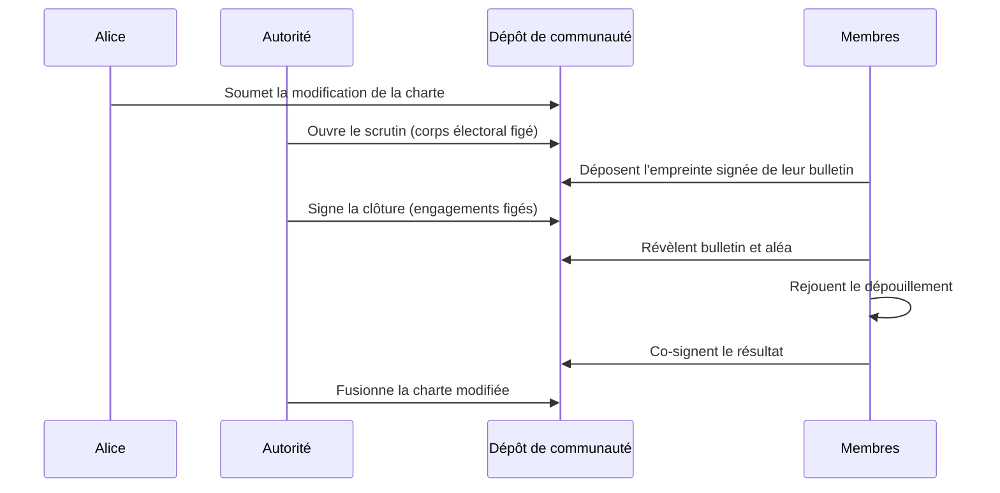

# **Modifier la charte par un scrutin scellé**

## Résumé
Alice propose de porter de sept à neuf le nombre de jetons par membre. La charte est un texte comme un autre : elle se modifie par un scrutin de toute la communauté. Pour que les premiers résultats n'influencent pas les derniers votants, les bulletins sont scellés pendant le vote, puis révélés après la clôture.

## Acteurs en jeu
- **Alice** : la membre qui propose la modification.
- **Les membres** : le corps électoral.
- **Autorité** : ouvre et clôt le scrutin, fusionne le résultat.
- **Dépôt de communauté** : porte la charte, le scrutin et les bulletins.

## Prérequis
- Alice est membre.
- La charte prévoit sa propre procédure de modification (quorum, durée, méthode).
- Le mode de secret retenu pour les scrutins de communauté est « scellé puis révélé ».

## Étapes du scénario
1. Alice rédige la modification de la notice `_Community.md` dans sa copie personnelle et la soumet, avec sa justification.
2. Une autorité ouvre le scrutin : la définition fige la liste des membres à cet instant, la question, les dates et le quorum.
3. Chaque membre choisit sa mention. Son application ne publie pas le bulletin mais son empreinte, mêlée à un aléa, signée.
4. À l'échéance, l'autorité signe la clôture, qui fige la liste des engagements reçus.
5. Chaque application révèle alors le bulletin et l'aléa ; le dépouillement vérifie que chacun correspond à l'engagement pris. Un bulletin non révélé est nul.
6. Le dépouillement est rejoué et co-signé par plusieurs membres (scénario 20).
7. Si la modification l'emporte et que le quorum est atteint, la transition est légale : la notice est mise à jour et signée.
8. À leur prochaine synchronisation, toutes les applications appliquent la nouvelle règle.

## Diagramme de séquence Mermaid

Ce diagramme montre que les règles de la communauté sont amendées avec l'outil même qu'elles régissent. Le scellement protège du vote suiveur, pas du regard d'autrui après révélation : le secret complet du vote reste une question ouverte du projet.

Cas d'utilisation : « Faire vivre la communauté ». Retour à l'analyse : [[KR Analyse]].
