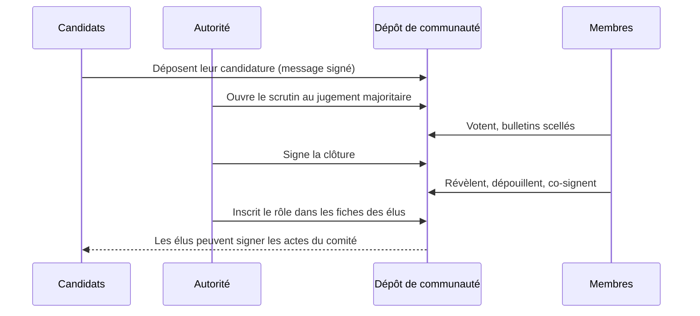

# **Élire un comité ou une autorité**

## Résumé
La Coopérative des Tilleuls élit les trois membres de son comité de pilotage. Il n'existe pas de compte privilégié : un rôle est une mention dans la fiche d'un membre, attribuée par un scrutin et vérifiée à chaque acte qui l'exige. La révocation suit le même chemin.

## Acteurs en jeu
- **Les membres** : candidats et électeurs.
- **Autorité** : ouvre le scrutin et fusionne le résultat.
- **Dépôt de communauté** : porte le scrutin et les fiches de membres.

## Prérequis
- La charte définit le rôle à pourvoir, le nombre de sièges et la durée du mandat.
- Un appel à candidatures a été annoncé par un message.

## Étapes du scénario
1. Les candidats se déclarent par un message signé qui cite l'appel à candidatures.
2. Une autorité ouvre le scrutin au jugement majoritaire, avec la liste des candidats et le corps électoral figé.
3. Chaque membre attribue une mention à chaque candidat ; les bulletins sont scellés jusqu'à la clôture (scénario 5).
4. À la clôture, le dépouillement classe les candidats ; les trois premiers sont élus.
5. Le résultat est co-signé par plusieurs membres qui l'ont recalculé.
6. La transition devient légale : le rôle `committee` et la date de fin de mandat sont inscrits dans les fiches des trois élus.
7. À partir de là, tout acte réservé au comité est refusé s'il ne porte pas la signature d'un membre dont la fiche porte ce rôle.
8. Pour révoquer un élu ou une autorité, un membre demande un scrutin de révocation ; s'il aboutit, le rôle est retiré de la fiche, qui en conserve la trace datée.

## Diagramme de séquence Mermaid

Ce diagramme illustre le principe de gouvernance de Kunereti : celui qui détient le bouton de fusion exécute, il ne décide pas. Autorités, examinateurs et comités tiennent leur rôle d'un vote, et le perdent de la même façon.

Cas d'utilisation : « Faire vivre la communauté ». Retour à l'analyse : [[KR Analyse]].
