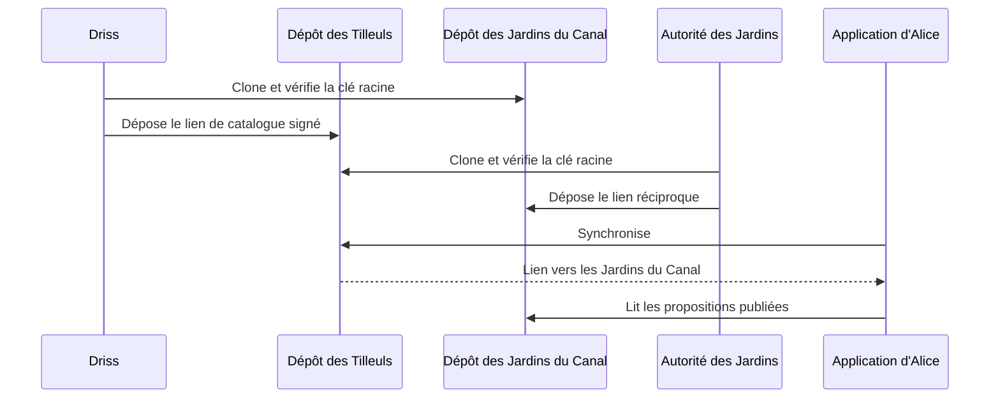

# **Relier deux communautés**

## Résumé
La Coopérative des Tilleuls et l'association voisine des Jardins du Canal veulent que leurs membres voient les propositions de l'autre. Chaque communauté inscrit dans son dépôt un lien signé vers le dépôt de l'autre. Il n'y a pas d'annuaire : la fédération est la somme de ces liens.

## Acteurs en jeu
- **Driss** : autorité de la communauté des Tilleuls.
- **Autorité des Jardins du Canal** : son homologue.
- **Les deux dépôts de communauté**.
- **Application d'un membre** : suit les liens.

## Prérequis
- Les deux communautés existent et ont chacune voté le principe du lien.
- Chaque autorité dispose du QR code de l'autre communauté.

## Étapes du scénario
1. Driss scanne le QR code des Jardins du Canal ; son application clone leur dépôt de communauté et vérifie leur clé racine.
2. Il crée dans le dépôt des Tilleuls un lien de catalogue : adresse du dépôt voisin, empreinte de sa clé racine, portée du lien (lecture des propositions publiées).
3. Le lien est signé par l'autorité, sur la foi du scrutin qui l'a décidé, puis fusionné.
4. L'autorité des Jardins du Canal fait de même dans son dépôt.
5. À la synchronisation suivante, l'application d'Alice découvre le lien et propose « Voir aussi : Jardins du Canal ».
6. Alice consulte les propositions publiées par la communauté voisine. Elle ne peut ni y voter ni y poser de jeton : pour cela, elle devrait y être admise.
7. Chaque communauté peut retirer le lien par un nouveau vote, sans demander l'accord de l'autre.

## Diagramme de séquence Mermaid

Ce diagramme montre une fédération sans centre : chaque communauté reste souveraine sur sa liste de membres et sur ses scrutins, et ne partage que ce qu'elle a décidé de montrer.

Cas d'utilisation : « Faire vivre la communauté ». Retour à l'analyse : [[KR Analyse]].
