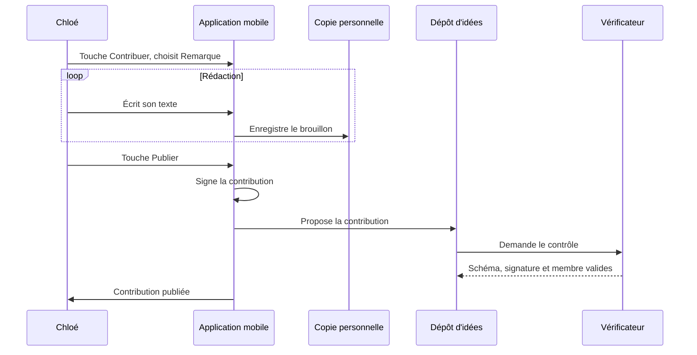

# **Publier une contribution**

## Résumé
Chloé a une remarque à faire sur les déplacements à la coopérative. Elle l'écrit dans l'application, sans titre ni mots-clés, et la publie. Tant qu'elle n'a pas publié, le texte n'existe que dans sa copie personnelle. Une fois publiée, la contribution est signée et ne change plus.

## Acteurs en jeu
- **Chloé** : la membre qui contribue.
- **Application mobile** : enregistre le brouillon, signe et envoie.
- **Dépôt d'idées** : reçoit la contribution.

## Prérequis
- Chloé est membre (scénario 3).
- Son téléphone a synchronisé le dépôt d'idées au moins une fois.
- Si la charte limite le nombre de publications par semaine (trois dans KuneAgi), Chloé n'a pas atteint cette limite.

## Étapes du scénario
1. Chloé touche « Contribuer ».
2. Elle indique qu'il s'agit d'une remarque, et rattache éventuellement sa contribution à un appel en cours.
3. Elle écrit son texte : « Je viendrais à vélo si je pouvais en emprunter un à la gare. » Elle peut joindre une image.
4. L'application enregistre le brouillon au fil de la saisie, dans la copie personnelle de Chloé. Chloé peut fermer l'application et reprendre plus tard, même sans réseau.
5. Chloé touche « Publier ». L'application lui rappelle que publier, c'est signer, et que le texte ne pourra plus être modifié.
6. L'application crée le fichier de contribution, le signe avec la clé de Chloé et le propose au dépôt d'idées.
7. Le vérificateur contrôle le schéma, la signature, la qualité de membre et, s'il y en a une, la limite hebdomadaire ; la contribution est fusionnée. Si la charte prévoit une modération avant publication, elle n'est affichée qu'après l'avis de trois membres tirés au sort (scénario 41).
8. L'application confirme la publication. La contribution sera lue par l'agent curateur à son prochain passage (scénario 11).

## Diagramme de séquence Mermaid

Ce diagramme illustre le remplacement du formulaire de création d'idée de 2017. Chloé ne décide pas si son texte est « une idée » : elle dit ce qu'elle a à dire, et le rangement se fait après, sans elle.

Cas d'utilisation : « Recueillir les contributions et tenir les idées ». Retour à l'analyse : [[KR Analyse]].
