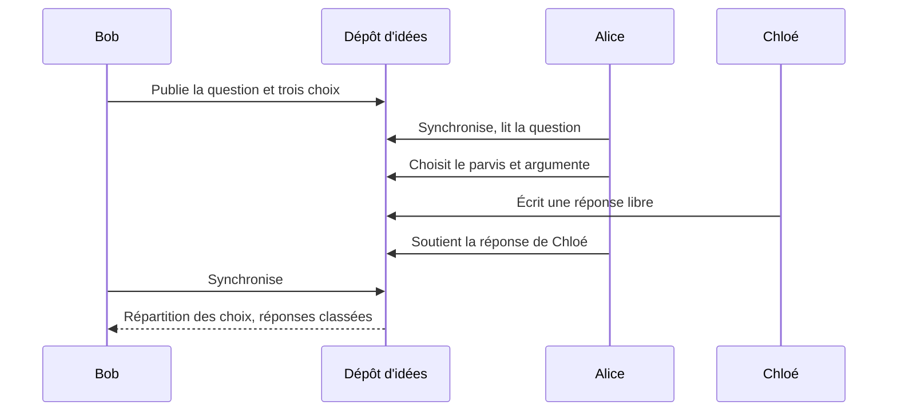

# **Poser une question et y répondre**

## Résumé
Bob veut savoir où installer un abri à vélos. Il pose une question à la communauté et propose trois emplacements. Alice choisit l'un d'eux et dit pourquoi ; Chloé écrit une réponse libre. Les réponses libres s'affichent par ordre de soutien.

## Acteurs en jeu
- **Bob** : l'auteur de la question.
- **Alice et Chloé** : les répondantes.
- **Application Kunereti**.
- **Dépôt d'idées** : porte la question et ses réponses.

## Prérequis
- Bob, Alice et Chloé sont membres.
- Leurs appareils sont synchronisés avec le dépôt d'idées.

## Étapes du scénario
1. Bob touche « Contribuer » et choisit « Question ».
2. Il écrit sa question et propose trois choix de réponse : la cour, le parvis, le parking.
3. Il publie ; la question est signée et rejoint le dépôt d'idées.
4. Alice ouvre la question, sélectionne « le parvis » et argumente son choix. Sa réponse est un message signé qui cite la question.
5. Chloé ne retient aucun des trois choix : elle écrit une réponse libre, « sous l'auvent de l'atelier ».
6. D'autres membres soutiennent la réponse de Chloé.
7. L'application de Bob affiche la répartition des choix, les arguments, et les réponses libres par ordre de soutien.
8. L'agent curateur lira question et réponses comme des contributions (scénario 11).

## Diagramme de séquence Mermaid

Ce diagramme montre que la question de Nova-Ideo est conservée telle quelle. Seul son support change : la question et chacune de ses réponses sont des fichiers signés, reliés par ce qu'ils citent.

Cas d'utilisation : « Recueillir les contributions et tenir les idées ». Retour à l'analyse : [[KR Analyse]].
