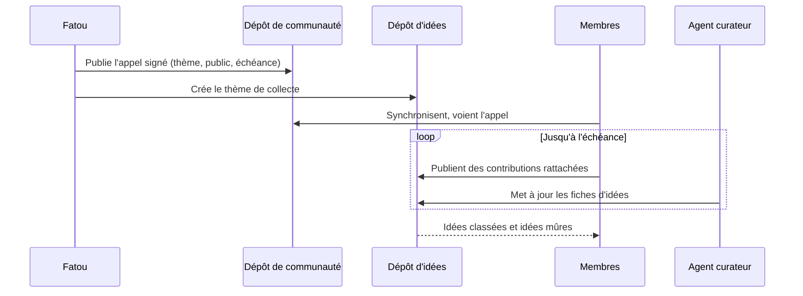

# **Lancer un appel à idées**

## Résumé
Fatou lance l'appel « Venir à la coopérative sans voiture ». Elle en rédige la problématique, choisit s'il est ouvert à tous les membres ou à une partie d'entre eux, et fixe une échéance. L'appel s'affiche en tête de l'accueil ; passé l'échéance, on n'y contribue plus.

## Acteurs en jeu
- **Fatou** : la membre qui lance l'appel.
- **Les membres** : ils contribuent.
- **Application Kunereti**.
- **Dépôt de communauté** : porte l'annonce de l'appel.
- **Dépôt d'idées** : reçoit les contributions.

## Prérequis
- Fatou est membre et la charte l'autorise à lancer un appel (tout membre, ou un rôle élu).
- La problématique est rédigée.

## Étapes du scénario
1. Fatou choisit « Lancer un appel à idées ».
2. Elle saisit le titre, la problématique, l'échéance et le public : tous les membres, ou une partie désignée.
3. L'application crée un message d'appel signé dans le dépôt de communauté et un thème de collecte dans le dépôt d'idées.
4. À leur synchronisation, les membres voient l'appel en tête de leur accueil.
5. Ils contribuent en rattachant leur texte à l'appel (scénario 8). Chacun voit les idées déjà dégagées et peut surenchérir ou les améliorer.
6. L'agent curateur regroupe les contributions en fiches d'idées, chacune avec le nombre de membres qui la portent.
7. À l'échéance, le vérificateur refuse toute nouvelle contribution rattachée à l'appel.
8. L'application présente le bilan : les idées classées, et celles que le curateur signale comme mûres.

## Diagramme de séquence Mermaid

Ce diagramme illustre la coopétition des *challenges* de 2017, avec une différence visible : les participants ne lisent plus cent idées dont trente sont la même, mais une douzaine de fiches qui disent combien de voix les portent.

Cas d'utilisation : « Recueillir les contributions et tenir les idées ». Retour à l'analyse : [[KR Analyse]].
