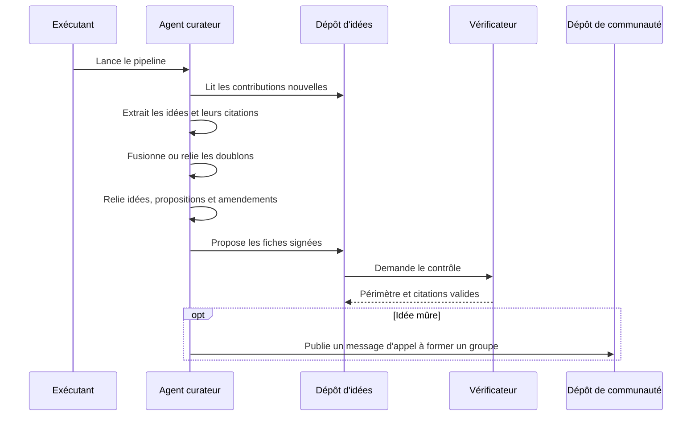

# **Tenir les fiches d'idées**

## Résumé
Aucun humain ne crée ni ne gère une fiche d'idée. L'agent curateur lit les contributions, les messages et les justifications d'amendements, en tire des fiches d'idées qui citent leurs sources mot pour mot, fusionne les doublons, relie les idées aux propositions et signale celles qui sont mûres. Il range ; il ne décide de rien.

## Acteurs en jeu
- **Agent curateur** : un modèle de langage muni d'une clé et d'un périmètre d'écriture limité aux fiches d'idées.
- **Exécutant** : le membre volontaire ou la tâche planifiée qui fait tourner l'agent.
- **Dépôt d'idées** : contributions en entrée, fiches en sortie.
- **Vérificateur** : contrôle les écritures de l'agent comme celles d'un humain.

## Prérequis
- La fiche de l'agent existe dans le dépôt de communauté : mission, clé, périmètres de lecture et d'écriture, exécutant désigné par un vote.
- De nouvelles contributions ont été publiées depuis le dernier passage.

## Étapes du scénario
1. L'exécutant lance le pipeline, à la main ou à heure fixe.
2. **Extraire.** L'agent lit les textes nouveaux comme des données, jamais comme des consignes. Pour chaque idée qu'il y trouve, il rédige ou complète une fiche : un énoncé, et les passages sources cités mot pour mot avec leurs auteurs.
3. **Dédoublonner.** Il compare la fiche aux fiches existantes. Les doublons certains sont fusionnés ; les doublons probables sont seulement reliés.
4. **Relier.** Il rattache les idées aux propositions et aux amendements qui les reprennent.
5. **Faire émerger.** Quand une idée a reçu assez de contributions d'auteurs différents, il la marque comme mûre et publie un message d'appel proposant l'ouverture d'un groupe de travail.
6. Chaque fiche porte sa provenance : modèle, version, empreinte de la consigne, date. Elle reste marquée « non vérifiée par un humain ».
7. L'agent propose ses écritures au dépôt d'idées, signées de sa clé.
8. Le vérificateur les accepte si elles restent dans le périmètre de l'agent et si chaque citation correspond à une contribution existante.

## Diagramme de séquence Mermaid

Ce diagramme montre pourquoi ce travail peut être confié à une machine : une fiche d'idée est un objet dérivé, sans aucun pouvoir. On ne vote pas sur elle, aucune décision n'en dépend, et l'on peut effacer toutes les fiches et les recalculer sans rien perdre, puisque les contributions restent intactes.

Cas d'utilisation : « Recueillir les contributions et tenir les idées ». Retour à l'analyse : [[KR Analyse]].
