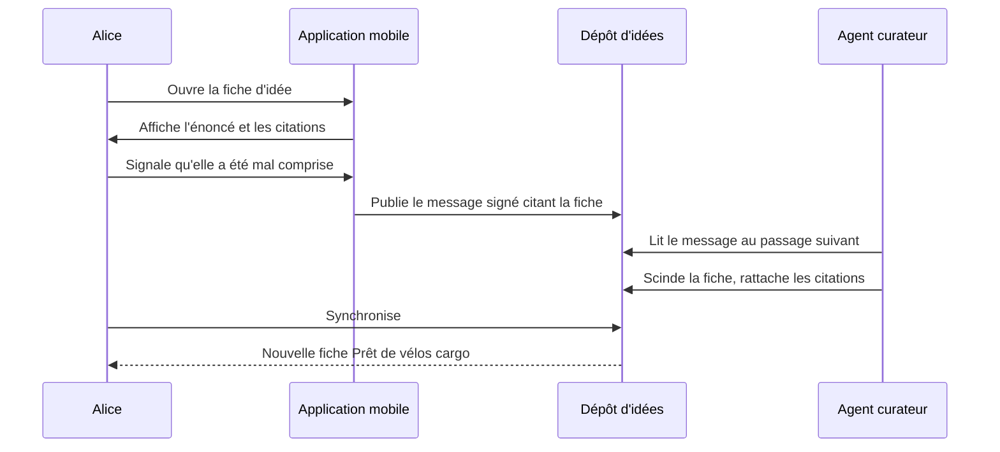

# **Contester une fiche d'idée**

## Résumé
Alice découvre que sa contribution sur le prêt de vélos cargo a été fusionnée dans la fiche « Vélos en libre-service », qui ne dit plus rien du transport de charges. Elle ne peut pas corriger la fiche, qui n'appartient à personne. Elle dit qu'elle a été mal comprise, et sa remarque devient une contribution que le curateur relit.

## Acteurs en jeu
- **Alice** : la membre mal résumée.
- **Application mobile**.
- **Agent curateur**.
- **Dépôt d'idées**.

## Prérequis
- Une fiche d'idée cite une contribution d'Alice.
- Alice a synchronisé le dépôt d'idées.

## Étapes du scénario
1. Alice ouvre la fiche d'idée et y retrouve sa phrase, citée mot pour mot à côté de celles d'autres membres.
2. Elle constate que l'énoncé de la fiche ne rend pas ce qu'elle voulait dire.
3. Elle touche « Ce n'est pas ce que j'ai dit » et précise : « Je parlais de vélos cargo, pour transporter du matériel, pas de vélos ordinaires. »
4. L'application publie un message signé qui cite la fiche.
5. Au passage suivant, l'agent curateur lit ce message comme une contribution de plus.
6. Il sépare l'idée « Prêt de vélos cargo » de la fiche d'origine et y rattache les citations d'Alice.
7. Alice retrouve sa contribution citée dans la nouvelle fiche.
8. Si le désaccord persiste, Alice peut rejouer le pipeline chez elle et publier l'écart (scénario 35).

## Diagramme de séquence Mermaid

Ce diagramme illustre le déplacement voulu par Kunereti : l'auteur ne défend plus *son* idée contre celle du voisin. S'il est mal compris, il le dit, ce qui ajoute une contribution au lieu d'ouvrir une querelle.

Cas d'utilisation : « Recueillir les contributions et tenir les idées ». Retour à l'analyse : [[KR Analyse]].
