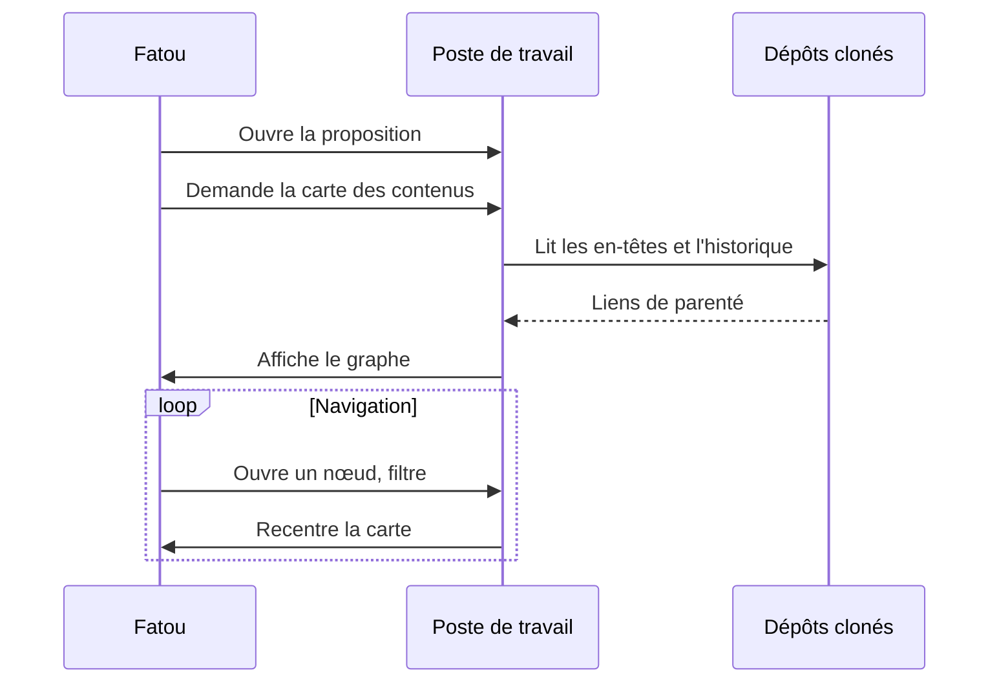

# **Explorer la carte des contenus**

## Résumé
Fatou veut comprendre d'où vient la proposition « Des vélos partagés ». Sur son poste de travail, elle ouvre la carte des contenus : contributions, idées, propositions, copies et amendements y sont reliés. Personne n'a saisi ces liens ; ils sont lus dans les en-têtes des fichiers et dans l'historique des dépôts.

## Acteurs en jeu
- **Fatou** : la membre qui consulte.
- **Poste de travail** : Obsidian ou le portail local, simple vue sur les dépôts clonés.
- **Dépôts clonés** : communauté, idées, groupes.

## Prérequis
- Fatou a cloné sur son poste les dépôts qui l'intéressent.
- L'index local a été reconstruit depuis les en-têtes des fichiers.

## Étapes du scénario
1. Fatou ouvre la proposition « Des vélos partagés » sur son poste.
2. Elle demande la carte des contenus centrée sur cette proposition.
3. Le poste lit les en-têtes : idées liées à la proposition, contributions citées par ces idées, amendements visant ses sections, copies du dépôt.
4. Il affiche le graphe, la proposition au centre.
5. Fatou clique sur l'idée « Vélos en libre-service » et lit les contributions dont elle est tirée.
6. Elle repère une copie de la proposition, poursuivie par un autre groupe (scénario 22), et l'ouvre.
7. Elle filtre la carte par type de contenu et par période.
8. Elle n'a rien modifié : la consultation ne produit aucun fichier et ne laisse aucune trace hors de son poste.

## Diagramme de séquence Mermaid

Ce diagramme montre un scénario sans écriture et sans réseau : tout se passe entre Fatou et ses copies locales. Personne, nulle part, ne sait ce qu'elle a consulté.

Cas d'utilisation : « Recueillir les contributions et tenir les idées ». Retour à l'analyse : [[KR Analyse]].
