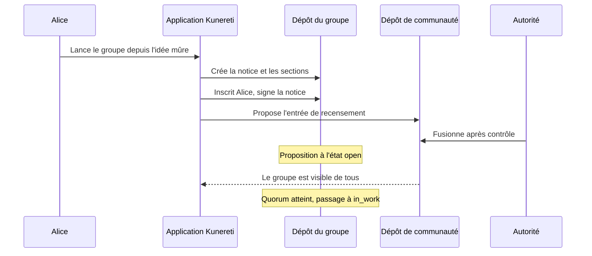

# **Ouvrir un groupe de travail**

## Résumé
L'agent curateur a signalé l'idée « Vélos en libre-service » comme mûre. Il propose ; un membre lance. Alice ouvre le groupe de travail : un dépôt est créé, avec une proposition dont le résumé reprend l'idée et dont le texte est découpé en sections. Le groupe est recensé dans le dépôt de communauté et attend ses participants.

## Acteurs en jeu
- **Alice** : la membre qui lance le groupe.
- **Application Kunereti**.
- **Dépôt du groupe** : créé par le scénario.
- **Dépôt de communauté** : recense le nouveau groupe.
- **Autorité** : fusionne le recensement.

## Prérequis
- Une idée est marquée mûre et un message d'appel propose un groupe (scénario 11).
- Alice participe à moins de cinq groupes.
- La communauté a éventuellement défini un modèle de document.

## Étapes du scénario
1. Alice ouvre le message d'appel du curateur et touche « Lancer le groupe de travail ».
2. Elle donne un titre à la proposition : « Des vélos partagés ».
3. L'application crée le dépôt `tilleuls--velos-partages--fr` : la notice `_Proposal.md`, dont le résumé reprend l'idée et qui cite les idées liées, et les sections vides du modèle de document.
4. Elle inscrit Alice comme première participante et signe la notice.
5. Le dépôt est publié sur les forges de la communauté.
6. L'application propose au dépôt de communauté l'entrée de recensement du groupe ; une autorité la fusionne après contrôle du vérificateur.
7. La proposition est à l'état `open` : elle recrute.
8. Quand le nombre minimal de participants fixé par la charte est atteint (trois par défaut dans KuneAgi, quel que soit le mode), elle passe à `in_work` et la première itération commence, en mode wiki par défaut.
9. La charte peut interdire de soumettre une proposition qui n'est pas passée par un groupe de travail : personne ne publie alors seul un texte « en l'état ».

## Diagramme de séquence Mermaid

Ce diagramme illustre la règle « un groupe, une proposition, un dépôt ». Le découpage du texte en sections, posé dès la création, est ce qui rendra les amendements praticables.

Cas d'utilisation : « Co-écrire une proposition en groupe de travail ». Retour à l'analyse : [[KR Analyse]].
