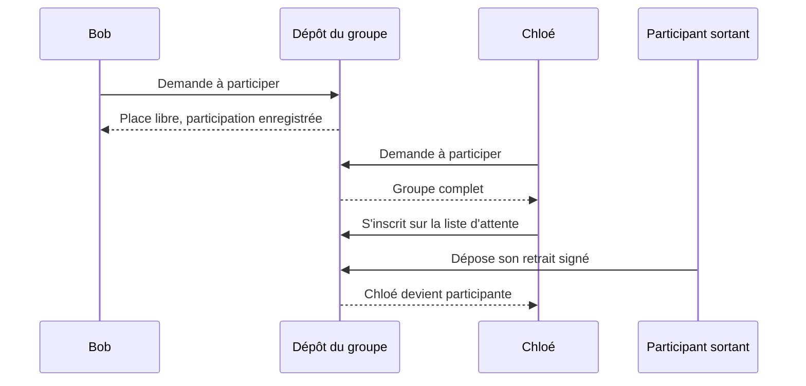

# **Rejoindre ou quitter un groupe de travail**

## Résumé
Bob rejoint le groupe « Des vélos partagés ». Chloé arrive quand le groupe compte déjà douze participants : elle s'inscrit sur la liste d'attente. Quand un participant quitte le groupe, la première personne de la liste prend sa place.

## Acteurs en jeu
- **Bob et Chloé** : les membres qui veulent participer.
- **Application mobile**.
- **Dépôt du groupe** : porte la liste des participants et la liste d'attente.

## Prérequis
- Le groupe est recensé dans la communauté (scénario 14).
- Bob et Chloé participent chacun à moins de cinq groupes.
- La charte fixe la taille maximale d'un groupe à douze.

## Étapes du scénario
1. Bob ouvre la proposition et touche « Participer ».
2. L'application vérifie qu'il reste une place et que Bob n'a pas atteint sa limite de cinq groupes.
3. Elle dépose la fiche de participation de Bob, signée, dans le dépôt du groupe. Bob peut désormais écrire et voter dans le groupe.
4. Plus tard, Chloé ouvre la même proposition. Le groupe est complet : le bouton indique « M'inscrire sur la liste d'attente ».
5. Chloé s'inscrit ; sa fiche est déposée avec son rang. Elle peut lire et discuter, mais pas voter.
6. Un participant quitte le groupe : il dépose son retrait signé. Son travail passé reste dans l'historique.
7. Chloé, première de la liste, devient participante.
8. Si un scrutin est en cours, son corps électoral ne change pas : Chloé votera au suivant.
9. Si le groupe a choisi de contrôler sa composition, l'entrée d'un nouveau participant est d'abord soumise au vote du groupe (scénario 44). En attendant une place, Chloé suit le groupe en observatrice (scénario 43).

## Diagramme de séquence Mermaid

Ce diagramme montre la règle du petit groupe héritée de Nova-Ideo. Elle n'est pas un réglage arbitraire : douze personnes qui écrivent dans le même dépôt s'entendent, cent se marchent dessus. Qui ne trouve pas de place peut aussi partir d'une copie (scénario 22).

Cas d'utilisation : « Co-écrire une proposition en groupe de travail ». Retour à l'analyse : [[KR Analyse]].
