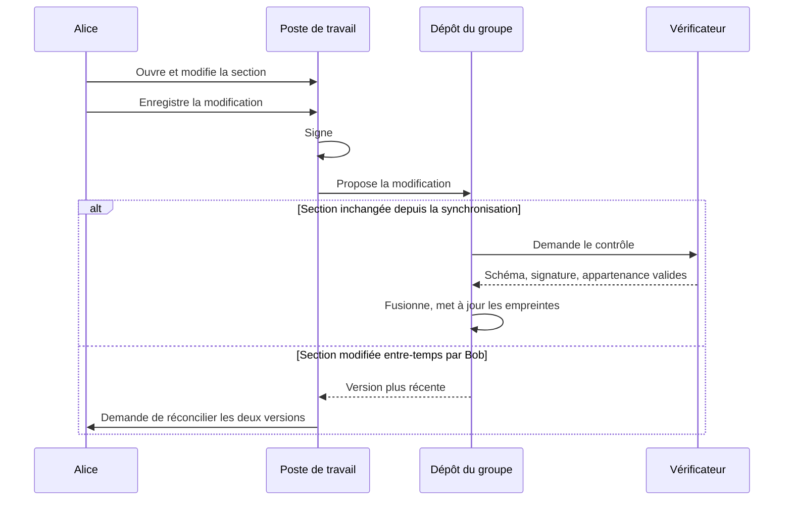

# **Modifier le texte en mode wiki**

## Résumé
Le groupe travaille en mode wiki. Alice rédige la section « Financement » ; chaque modification qu'elle enregistre produit une nouvelle version, sans validation. Le vote de publication portera sur une version précise, désignée par son empreinte : une retouche de dernière minute donne une autre version, sur laquelle personne n'a voté.

## Acteurs en jeu
- **Alice** : participante du groupe.
- **Poste de travail** : Obsidian ou le portail local.
- **Dépôt du groupe**.
- **Vérificateur**.

## Prérequis
- L'itération en cours est en mode wiki.
- Alice est participante du groupe.
- Son poste a synchronisé le dépôt du groupe.

## Étapes du scénario
1. Alice ouvre la section « Financement » sur son poste.
2. Elle rédige. Son travail en cours reste dans sa copie personnelle.
3. Elle enregistre sa modification, avec une phrase qui dit ce qu'elle a changé.
4. Le poste signe la modification et la propose au dépôt du groupe.
5. Le vérificateur contrôle trois choses seulement : le schéma, la signature d'Alice et son appartenance au groupe.
6. La modification est fusionnée ; l'empreinte de la section et celle de la proposition sont mises à jour.
7. Si Bob a modifié la même section entre-temps, le poste d'Alice lui montre les deux versions et lui demande de les réconcilier avant d'envoyer.
8. Les autres participants voient la nouvelle version à leur synchronisation.

## Diagramme de séquence Mermaid

Ce diagramme illustre le mode qui convient dans la plupart des cas, au démarrage, quand le texte est encore informe. Son défaut de 2017, le poids donné à celui qui modifie le dernier, a disparu : on vote sur une empreinte, pas sur un titre.

Cas d'utilisation : « Co-écrire une proposition en groupe de travail ». Retour à l'analyse : [[KR Analyse]].
