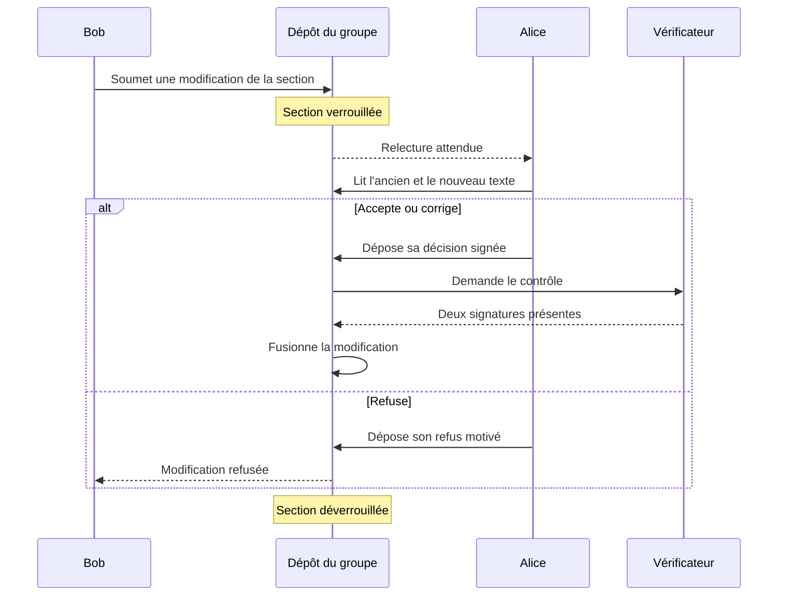

# **Modifier le texte en mode avec validation**

## Résumé
Le groupe a choisi le mode avec validation pour une itération de relecture. Bob corrige la formulation de la section « Objectifs ». Sa modification n'entre dans le texte que lorsqu'un autre participant, ici Alice, l'a acceptée, refusée ou corrigée. Le processus est séquentiel : une seule modification en attente par section.

## Acteurs en jeu
- **Bob** : l'auteur de la modification.
- **Alice** : la participante qui relit.
- **Dépôt du groupe**.
- **Vérificateur**.

## Prérequis
- L'itération en cours est en mode avec validation.
- Bob et Alice sont participants.
- Aucune modification n'est en attente sur la section visée.

## Étapes du scénario
1. Bob modifie la section « Objectifs » et soumet sa modification.
2. La section est verrouillée : tant que la modification de Bob n'est pas traitée, personne ne peut en soumettre une autre sur cette section.
3. Les autres participants sont notifiés qu'une relecture est attendue.
4. Alice ouvre la modification : l'ancien texte et le nouveau s'affichent côte à côte.
5. Elle choisit : accepter, refuser en disant pourquoi, ou corriger.
6. Elle corrige une tournure et valide. Sa décision est une fiche signée.
7. Le vérificateur exige les deux signatures, celle de l'auteur et celle d'un autre participant, avant d'accepter la fusion.
8. La section est déverrouillée et la modification suivante peut être soumise.

## Diagramme de séquence Mermaid

Ce diagramme montre le mode le plus adapté aux corrections de forme. Personne ne valide son propre texte : la seconde signature est celle d'un autre.

Cas d'utilisation : « Co-écrire une proposition en groupe de travail ». Retour à l'analyse : [[KR Analyse]].
