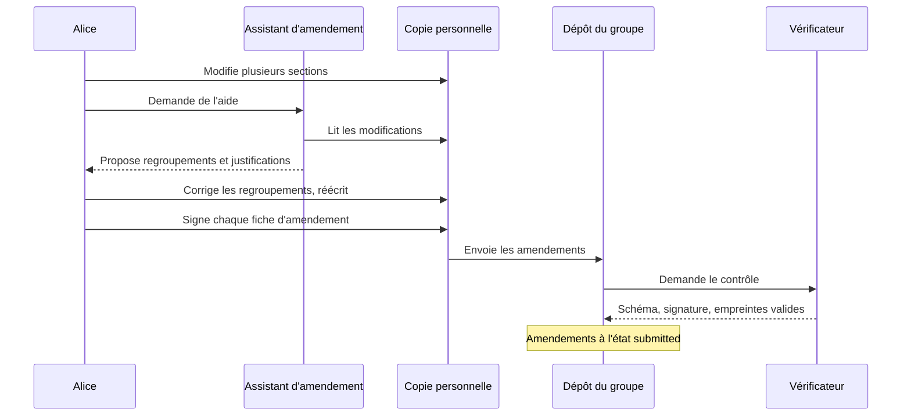

# **Préparer et soumettre un amendement**

## Résumé
Le groupe travaille en mode avec amendements. Alice a modifié la proposition dans sa copie pour élargir le service aux vélos cargo, et en a profité pour reformuler quelques phrases. Avant de soumettre, elle doit regrouper ses modifications par intention et justifier chacune. Un assistant, qui tourne sur son poste et ne lit que sa copie, lui propose un regroupement ; Alice corrige, décide et signe.

## Acteurs en jeu
- **Alice** : l'auteure des amendements.
- **Assistant d'amendement** : un modèle de langage local, sans droit d'écriture dans les dépôts partagés.
- **Copie personnelle d'Alice**.
- **Dépôt du groupe**.
- **Vérificateur**.

## Prérequis
- L'itération en cours est en mode avec amendements et n'est pas échue.
- Alice est participante.
- Elle a modifié une ou plusieurs sections dans sa copie personnelle.

## Étapes du scénario
1. Alice termine ses modifications et ouvre l'écran « Mes amendements ».
2. Le poste affiche la liste de ses modifications, calculée par comparaison avec la version du groupe.
3. Alice demande l'aide de l'assistant.
4. L'assistant propose deux regroupements : « Étendre aux vélos cargo », qui réunit trois modifications dispersées, et « Reformulations », qui réunit les autres. Il propose pour chacun un premier jet de justification et les idées auxquelles le rattacher.
5. Alice déplace une modification d'un groupe à l'autre et réécrit la justification du premier.
6. Pour chaque amendement, le poste crée une fiche : intention, justification, sections visées avec leur empreinte de départ, idées liées.
7. Alice signe chaque fiche. L'assistant ne signe rien et ne soumet rien.
8. Le poste envoie les amendements au dépôt du groupe ; le vérificateur contrôle le schéma, la signature et les empreintes de départ. Les amendements sont à l'état `submitted` et resteront modifiables par leur auteure jusqu'à l'échéance.

## Diagramme de séquence Mermaid

Ce diagramme illustre l'écran qui était le plus difficile de Nova-Ideo, et celui où un modèle de langage aide le plus. La règle « un amendement, une intention » est tenue par l'auteure : la machine propose un découpage, elle n'engage personne.

Cas d'utilisation : « Co-écrire une proposition en groupe de travail ». Retour à l'analyse : [[KR Analyse]].
