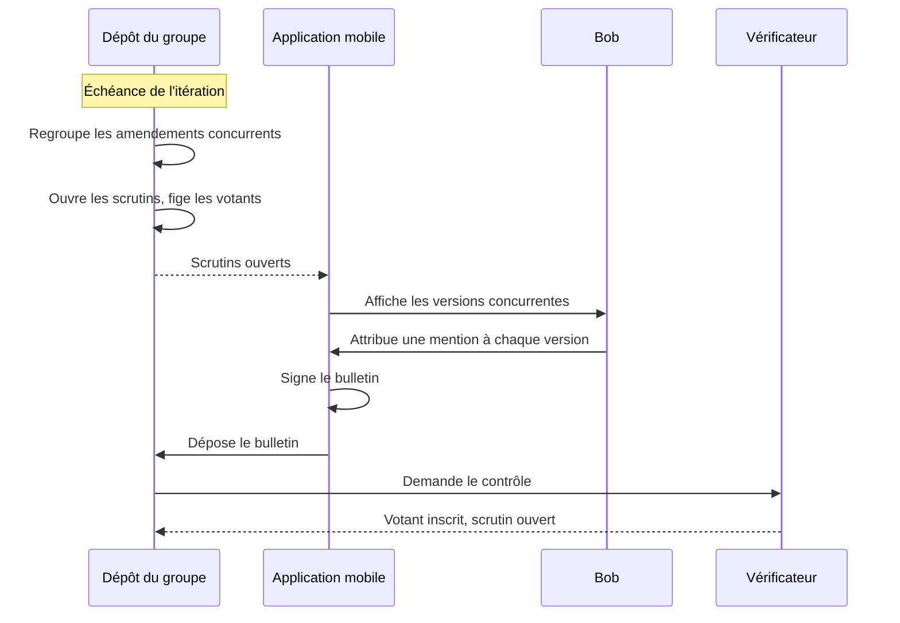

# **Voter les amendements au jugement majoritaire**

## Résumé
L'itération est échue. Les amendements qui portent sur les mêmes passages sont regroupés en un seul scrutin et votés les uns contre les autres et contre le texte d'origine. Bob attribue à chaque version l'une des sept mentions, de « Excellent » à « À rejeter ». Son bulletin est un fichier signé.

## Acteurs en jeu
- **Bob** : participant, électeur.
- **Application mobile**.
- **Dépôt du groupe** : porte le scrutin et les bulletins.
- **Vérificateur**.

## Prérequis
- Le délai de l'itération est écoulé.
- Des amendements sont à l'état `submitted`.
- Bob est participant du groupe à l'ouverture du scrutin.

## Étapes du scénario
1. À l'échéance, la transition d'ouverture des votes est déclenchée. Le calcul des recouvrements, fait sur le texte et non par un modèle de langage, regroupe les amendements concurrents.
2. Pour chaque groupe d'amendements, un scrutin est créé : les candidats sont chaque amendement et le texte d'origine ; la liste des votants est figée ; la clôture est datée.
3. Bob reçoit la notification « 2 scrutins à voter ».
4. Il ouvre le premier : l'application lui montre les versions concurrentes, avec l'intention et la justification de chaque amendement.
5. Il attribue une mention à chaque version, texte d'origine compris.
6. Il valide. L'application crée son bulletin, le signe (la signature couvre l'identifiant du scrutin et ses choix) et le dépose : un fichier par votant.
7. Le vérificateur contrôle que Bob appartient au corps électoral et que le scrutin est ouvert.
8. Bob peut modifier son bulletin jusqu'à la clôture ; seul le dernier compte. Dans un groupe de douze, le vote est nominatif sous pseudonyme.

## Diagramme de séquence Mermaid

Ce diagramme montre qu'on ne vote jamais « pour ou contre » un amendement qui a un rival : on juge toutes les versions, y compris celle qui ne change rien. Le dépouillement fait l'objet du scénario 20.

Cas d'utilisation : « Co-écrire une proposition en groupe de travail ». Retour à l'analyse : [[KR Analyse]].
