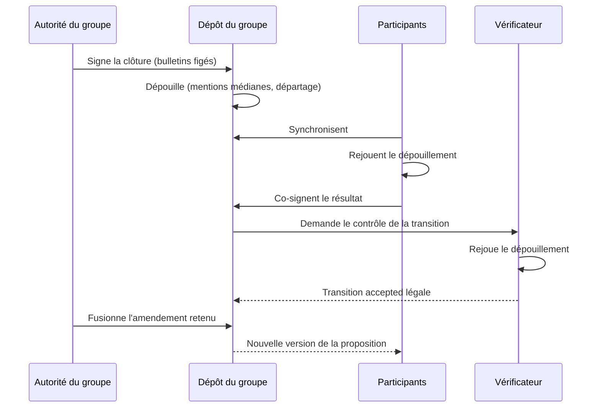

# **Dépouiller le scrutin et produire la nouvelle version**

## Résumé
Le scrutin se clôt. La liste des bulletins reçus est figée, puis le dépouillement est calculé : la version retenue est celle dont la mention médiane est la meilleure. Chaque participant peut refaire le calcul sur son téléphone, et le résultat n'est valable que s'il est co-signé par plusieurs d'entre eux. Les amendements retenus sont alors appliqués, ce qui produit la nouvelle version.

## Acteurs en jeu
- **Les participants** : ils rejouent le dépouillement et le co-signent.
- **Autorité du groupe** : signe la clôture et exécute la fusion.
- **Dépôt du groupe**.
- **Vérificateur** : rejoue lui aussi le calcul.

## Prérequis
- Le scrutin est ouvert et sa date de clôture est atteinte.
- Le quorum fixé par la charte est atteint ; sinon le scrutin est sans effet et le texte d'origine est conservé.

## Étapes du scénario
1. À l'échéance, la clôture est signée : elle fige l'empreinte de la liste des bulletins reçus. Un bulletin absent de cette liste est refusé, quelle que soit la date qu'il porte.
2. Le script de dépouillement écarte les bulletins hors corps électoral ou mal signés.
3. Il calcule la mention médiane de chaque version ; en cas d'égalité, il applique la règle de départage du jugement majoritaire.
4. Il écrit le résultat dans la définition du scrutin.
5. Les applications de plusieurs participants refont le calcul. Si elles trouvent le même résultat, leurs propriétaires le co-signent.
6. Quand le nombre de co-signatures exigé est atteint, la transition `accepted` de l'amendement gagnant est légale ; les autres passent à `rejected`.
7. Le vérificateur rejoue le dépouillement, puis l'autorité fusionne l'amendement retenu : les sections et leurs empreintes sont mises à jour.
8. Si le texte de départ a bougé depuis la soumission, l'auteur doit d'abord remettre son amendement à jour et le re-signer.
9. La nouvelle version est affichée : chaque changement renvoie à l'amendement et au scrutin qui l'ont produit.

## Diagramme de séquence Mermaid

Ce diagramme illustre ce qui a changé depuis 2017 : non pas le scrutin, mais sa vérification. Il n'y a plus à croire le logiciel qui « calcule la médiane » ; personne n'a à être cru, puisque chacun peut recompter.

Cas d'utilisation : « Co-écrire une proposition en groupe de travail ». Retour à l'analyse : [[KR Analyse]].
