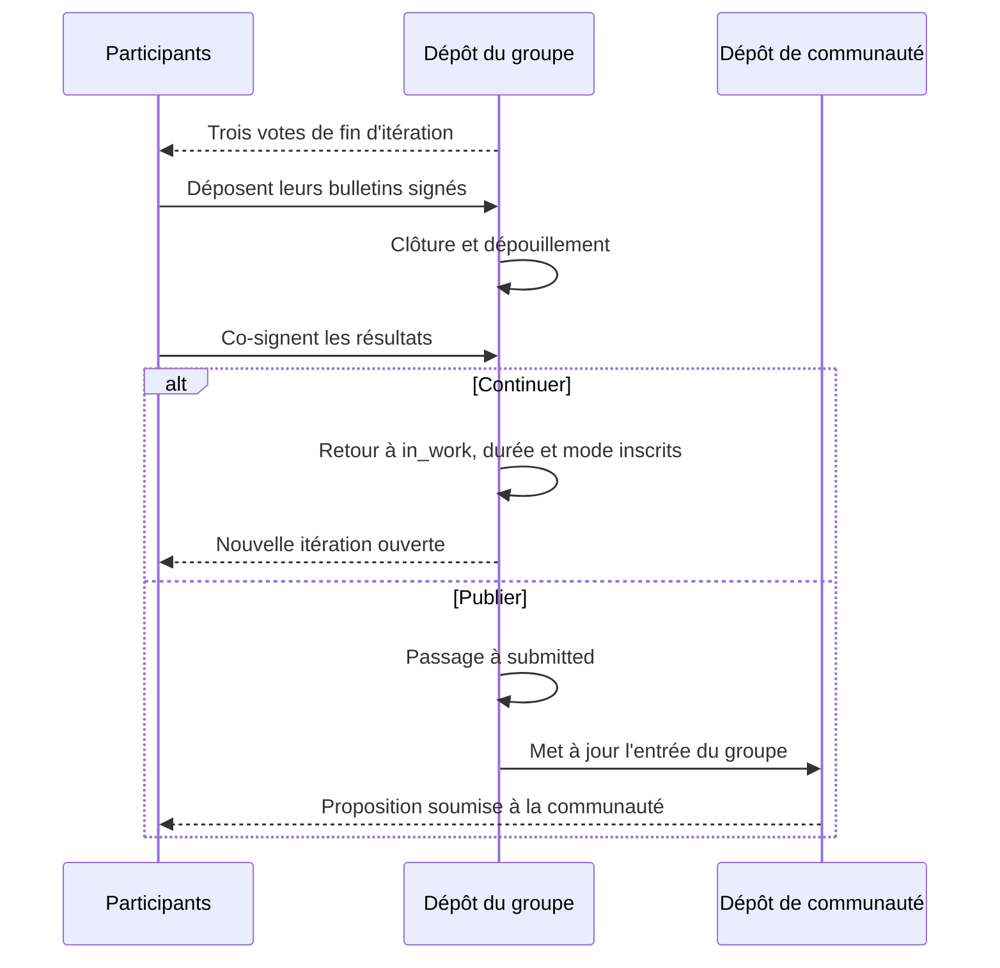

# **Clore l'itération : publier ou continuer**

## Résumé
Les amendements sont dépouillés et la nouvelle version est produite. Le groupe vote : soumettre la proposition à toute la communauté, ou repartir pour un tour. S'il repart, il vote aussi la durée de l'itération suivante et son mode de travail.

## Acteurs en jeu
- **Les participants** du groupe.
- **Application mobile**.
- **Dépôt du groupe**.
- **Dépôt de communauté** : reçoit l'état de la proposition soumise.

## Prérequis
- La proposition est à l'état `publication_vote`.
- La version soumise au vote est désignée par son empreinte.

## Étapes du scénario
1. Chaque participant reçoit trois questions : publier ou continuer ; durée de la prochaine itération ; mode de travail (wiki, validation, amendements).
2. L'application rappelle l'empreinte de la version sur laquelle porte le vote de publication.
3. Chaque participant vote ; les bulletins sont des fichiers signés.
4. À la clôture, les trois scrutins sont dépouillés et co-signés (scénario 20).
5. Si « continuer » l'emporte : la proposition revient à `in_work`. La durée et le mode retenus sont inscrits dans la notice et couverts par la signature qui ouvre la nouvelle itération.
6. Si « publier » l'emporte : la proposition passe à `submitted`. Les réponses aux deux autres questions sont sans objet.
7. L'entrée du groupe dans le dépôt de communauté est mise à jour : la proposition devient visible de tous les membres, qui peuvent la soutenir ou la rejeter (scénario 30).
8. L'application rappelle l'échéance de la nouvelle itération à ceux qui continuent.

## Diagramme de séquence Mermaid

Ce diagramme montre le *timeboxing* repris des méthodes agiles : les cycles courts évitent l'enlisement, et ce sont les participants, non l'outil, qui règlent le rythme et la méthode.

Cas d'utilisation : « Co-écrire une proposition en groupe de travail ». Retour à l'analyse : [[KR Analyse]].
