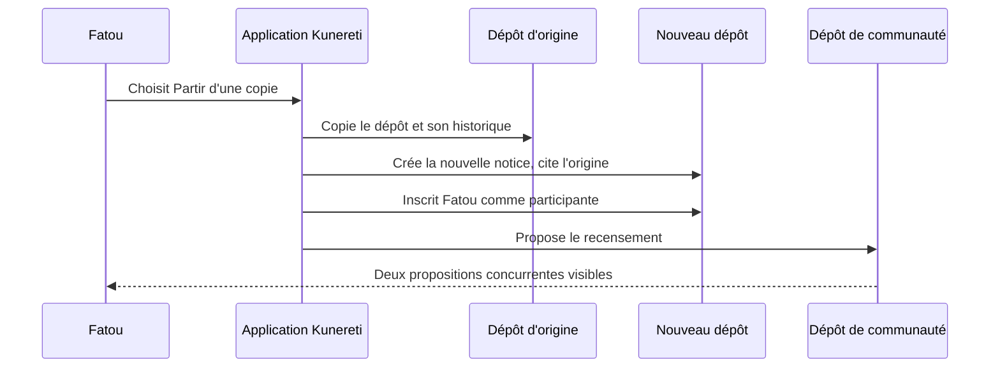

# **Dupliquer une proposition**

## Résumé
Fatou ne partage pas l'orientation prise par le groupe « Des vélos partagés », qui a écarté la location payante. Elle ne bloque personne : elle copie le dépôt du groupe, avec tout son historique, et ouvre un groupe concurrent. Les deux propositions seront soumises au soutien de tous.

## Acteurs en jeu
- **Fatou** : la membre qui duplique.
- **Application Kunereti**.
- **Dépôt du groupe d'origine**.
- **Nouveau dépôt** : la copie.
- **Dépôt de communauté**.

## Prérequis
- Fatou est membre et participe à moins de cinq groupes.
- Le dépôt d'origine lui est lisible.

## Étapes du scénario
1. Fatou ouvre la proposition et choisit « Partir d'une copie ».
2. L'application copie le dépôt : texte, historique, amendements, messages, votes. La paternité de chaque phrase reste inscrite.
3. Fatou donne un nouveau titre : « Des vélos en location solidaire ».
4. L'application crée une nouvelle notice, avec un nouvel identifiant, qui cite la proposition d'origine et la version dont elle part.
5. Les participants et les scrutins de l'ancien groupe ne sont pas repris : le nouveau groupe part avec Fatou seule.
6. Le nouveau dépôt est publié et recensé dans le dépôt de communauté (scénario 14).
7. La carte des contenus montre désormais les deux propositions et leur ancêtre commun.
8. Chaque groupe poursuit ses itérations ; les membres de la communauté arbitreront par leurs jetons.

## Diagramme de séquence Mermaid

Ce diagramme illustre le droit de sortie : le fork, métaphore empruntée au logiciel libre en 2017, est devenu le mécanisme lui-même. Le travail n'est jamais perdu, et un groupe en désaccord ne se bloque pas.

Cas d'utilisation : « Co-écrire une proposition en groupe de travail ». Retour à l'analyse : [[KR Analyse]].
