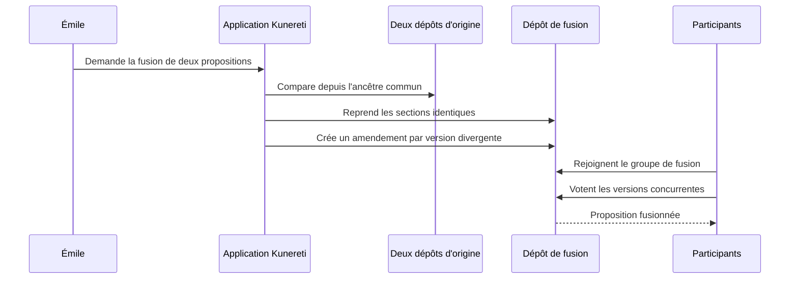

# **Fusionner deux propositions concurrentes**

## Résumé
Deux propositions concurrentes sur les vélos ont été publiées et se partagent les soutiens. Émile propose de les réunir. Il ouvre un groupe de fusion à partir des deux dépôts, qui ont un ancêtre commun : les sections identiques sont reprises, les sections divergentes sont présentées côte à côte et deviennent des amendements concurrents, tranchés par le vote.

## Acteurs en jeu
- **Émile** : le membre qui lance la fusion.
- **Application Kunereti**.
- **Les deux dépôts d'origine**.
- **Dépôt du groupe de fusion**.
- **Participants du groupe de fusion**.

## Prérequis
- Les deux propositions ont un ancêtre commun (scénario 22) ou le même modèle de document.
- Émile participe à moins de cinq groupes.

## Étapes du scénario
1. Émile ouvre l'une des deux propositions et choisit « Fusionner avec une autre proposition ».
2. Il désigne la seconde. L'application compare les deux dépôts à partir de leur ancêtre commun.
3. Elle crée un nouveau dépôt de groupe : les sections restées identiques sont reprises telles quelles.
4. Pour chaque section divergente, elle garde le texte de l'ancêtre et crée deux amendements, un par version, attribués à leurs groupes d'origine.
5. Le groupe de fusion est recensé ; les participants des deux groupes sont invités à le rejoindre, dans la limite de douze.
6. Le groupe travaille en mode avec amendements : les versions concurrentes sont votées au jugement majoritaire, texte d'origine compris (scénarios 19 et 20).
7. La proposition fusionnée suit ensuite le cycle ordinaire, jusqu'au vote de publication.
8. Les deux propositions d'origine restent consultables ; leurs groupes décident eux-mêmes de les archiver ou non.

## Diagramme de séquence Mermaid

Ce diagramme montre que la recommandation de 2017, « plusieurs petits groupes en concurrence sur le même sujet, quitte à ce qu'un autre fusionne leurs propositions », est devenue une opération ordinaire entre deux dépôts. La machine prépare la comparaison ; ce sont les participants qui tranchent.

Cas d'utilisation : « Co-écrire une proposition en groupe de travail ». Retour à l'analyse : [[KR Analyse]].
