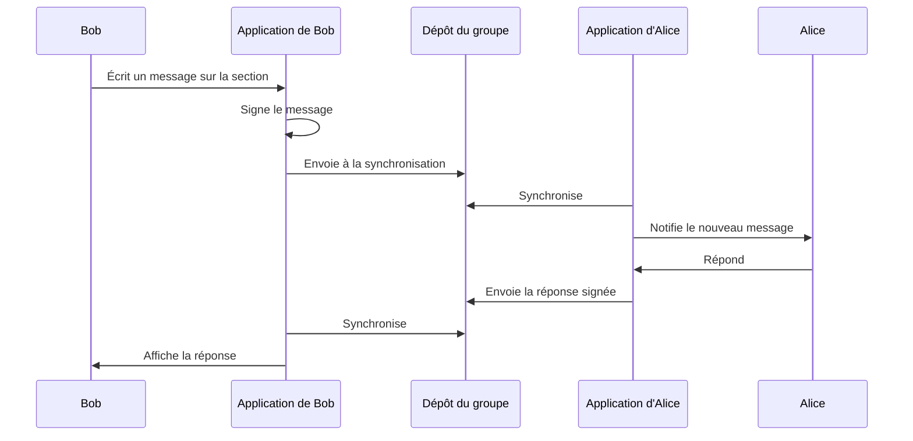

# **Discuter d'un contenu**

## Résumé
Bob ne comprend pas le second paragraphe de la section « Financement ». Il écrit un message sur cette section ; Alice lui répond. Chaque message est un petit fichier signé qui dit de quoi il parle et à quoi il répond. Ce n'est pas une messagerie instantanée : un message part à la synchronisation de l'un et arrive à celle de l'autre.

## Acteurs en jeu
- **Bob** : l'auteur du message.
- **Alice** : celle qui répond.
- **Applications** de Bob et d'Alice.
- **Dépôt du groupe** : porte les messages.

## Prérequis
- Bob et Alice ont accès au dépôt du groupe.
- La section discutée existe.

## Étapes du scénario
1. Bob ouvre la section « Financement » et touche « Discuter ».
2. L'application affiche le fil : tous les messages qui citent cette section, dans l'ordre.
3. Bob écrit : « Qui paie la première année ? » Il peut joindre une image ou un lien.
4. L'application crée le message, le signe et l'envoie à la prochaine synchronisation. Deux messages écrits en même temps ne se gênent pas : chacun est un fichier distinct.
5. Le téléphone d'Alice se synchronise ; elle est notifiée parce qu'elle a rédigé cette section.
6. Alice répond. Son message cite celui de Bob.
7. À sa synchronisation suivante, Bob lit la réponse.
8. Le fil reste attaché à la section, y compris dans les copies du dépôt.

## Diagramme de séquence Mermaid

Ce diagramme illustre un débat au rythme du courrier, pas à celui du clavardage. Aucun canal de discussion n'est créé ni stocké : le fil est une simple requête sur ce que citent les messages.

Cas d'utilisation : « Discuter ». Retour à l'analyse : [[KR Analyse]].
