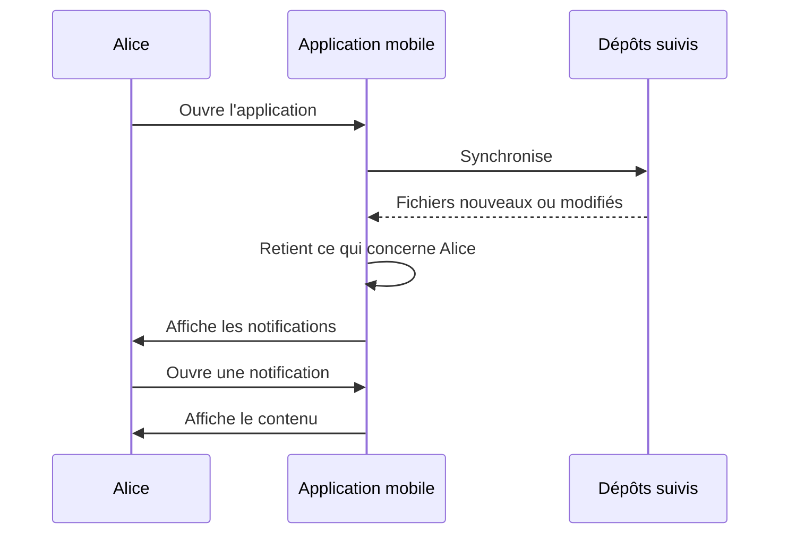

# **Consulter ses notifications**

## Résumé
Alice ouvre l'application le matin. Aucun serveur ne lui a rien poussé : son téléphone se synchronise, regarde ce qui a changé depuis la veille dans les dépôts qu'elle suit, et en déduit ce qui la concerne.

## Acteurs en jeu
- **Alice** : la membre.
- **Application mobile** : calcule les notifications.
- **Dépôts suivis** : communauté, idées, groupes d'Alice.

## Prérequis
- Alice est membre et participe à au moins un groupe.
- Son téléphone a déjà synchronisé une première fois.
- Le réseau est disponible.

## Étapes du scénario
1. Alice ouvre l'application, ou celle-ci se réveille à l'heure qu'Alice a réglée.
2. L'application synchronise les dépôts suivis et note le point où elle s'était arrêtée la fois précédente.
3. Elle parcourt les fichiers nouveaux ou modifiés depuis ce point.
4. Elle retient ceux qui concernent Alice : elle en est l'auteure, elle participe au groupe, elle est citée, ou elle s'est abonnée au contenu.
5. Elle affiche la liste : « 2 scrutins à voter », « Bob a répondu à votre message », « Votre amendement est mis au vote », « L'itération se termine dans deux jours ».
6. Alice touche une notification ; l'application ouvre le contenu.
7. Elle règle ses abonnements. Ce réglage reste sur son téléphone.
8. Si la forge de la communauté sait envoyer des courriels, Alice peut les activer : c'est un accélérateur, pas une dépendance.

## Diagramme de séquence Mermaid

Ce diagramme montre une conséquence discrète mais importante de l'absence de serveur : personne, nulle part, ne détient la liste de ce qui intéresse Alice.

Cas d'utilisation : « Discuter ». Retour à l'analyse : [[KR Analyse]].
