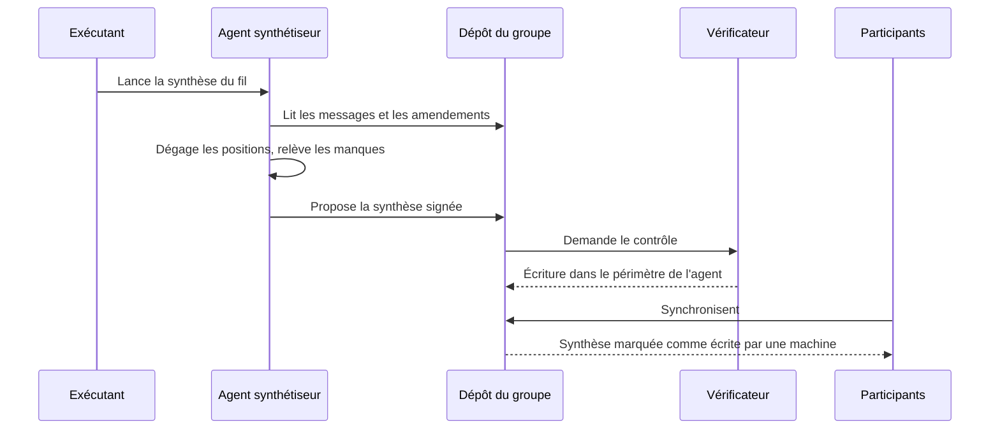

# **Synthétiser un fil de discussion**

## Résumé
Le fil sur le financement dépasse soixante messages. L'agent synthétiseur en rédige un résumé : les positions en présence, qui les tient, et ce qu'aucun amendement ne couvre encore. La synthèse est toujours affichée comme écrite par une machine. Elle n'arbitre pas et ne recommande aucun vote.

## Acteurs en jeu
- **Agent synthétiseur** : un modèle de langage dont le périmètre d'écriture est limité aux synthèses.
- **Exécutant** : fait tourner l'agent.
- **Dépôt du groupe**.
- **Vérificateur**.
- **Les participants** : lecteurs de la synthèse.

## Prérequis
- La fiche de l'agent existe dans le dépôt de communauté.
- Le fil a dépassé le seuil de messages fixé par le groupe, ou une itération s'achève.

## Étapes du scénario
1. L'exécutant lance l'agent sur le dépôt du groupe.
2. L'agent lit les messages du fil et les amendements de l'itération, comme des données.
3. Il dégage les positions et rattache à chacune les messages qui la portent.
4. Il relève les objections restées sans réponse et les points qu'aucun amendement ne traite.
5. Il rédige la synthèse, avec les références aux messages et sa provenance (modèle, version, date), et la signe de sa clé.
6. Il la propose au dossier des synthèses ; le vérificateur contrôle qu'il n'a écrit nulle part ailleurs.
7. L'application affiche la synthèse en tête du fil, sous l'avertissement « Synthèse rédigée par une machine ».
8. Un participant qui la trouve infidèle le dit dans le fil ; l'agent en tiendra compte à son prochain passage.

## Diagramme de séquence Mermaid

Ce diagramme illustre la frontière posée aux agents : ils résument, ils n'arbitrent pas. Sans modèle de langage, le groupe perd les synthèses, pas la délibération.

Cas d'utilisation : « Discuter ». Retour à l'analyse : [[KR Analyse]].
