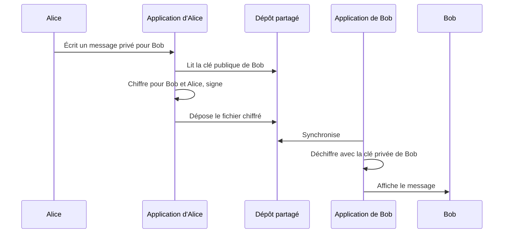

# **Envoyer un message privé**

## Résumé
Alice veut dire à Bob, sans que le groupe le lise, qu'elle trouve son amendement prématuré. Son application chiffre le message pour la clé publique de Bob et pour la sienne, puis le dépose. Le dépôt ne révèle que l'existence du message et sa taille.

## Acteurs en jeu
- **Alice** : l'expéditrice.
- **Bob** : le destinataire.
- **Applications** d'Alice et de Bob.
- **Dépôt du groupe** ou dépôt privé partagé entre les deux.

## Prérequis
- Alice et Bob sont membres ; leurs clés publiques de chiffrement figurent dans leurs fiches.
- Ils partagent au moins un dépôt.

## Étapes du scénario
1. Alice ouvre la fiche de Bob et touche « Message privé ».
2. Elle écrit son message.
3. L'application lit la clé publique de chiffrement de Bob dans sa fiche de membre.
4. Elle chiffre le message pour Bob et pour Alice, signe l'ensemble et dépose le fichier.
5. Le téléphone de Bob se synchronise et repère un message chiffré qui lui est destiné.
6. Il le déchiffre avec la clé privée de Bob, qui n'a jamais quitté le téléphone.
7. Bob lit le message et répond de la même façon.
8. Les autres membres voient qu'un fichier chiffré existe ; ils ne peuvent pas le lire.

## Diagramme de séquence Mermaid

Ce diagramme montre que le secret d'un message ne dépend pas de l'hébergeur. Il a deux limites à dire aux membres : l'existence de l'échange est visible, et qui perd sa clé perd ses messages (scénario 4).

Cas d'utilisation : « Discuter ». Retour à l'analyse : [[KR Analyse]].
