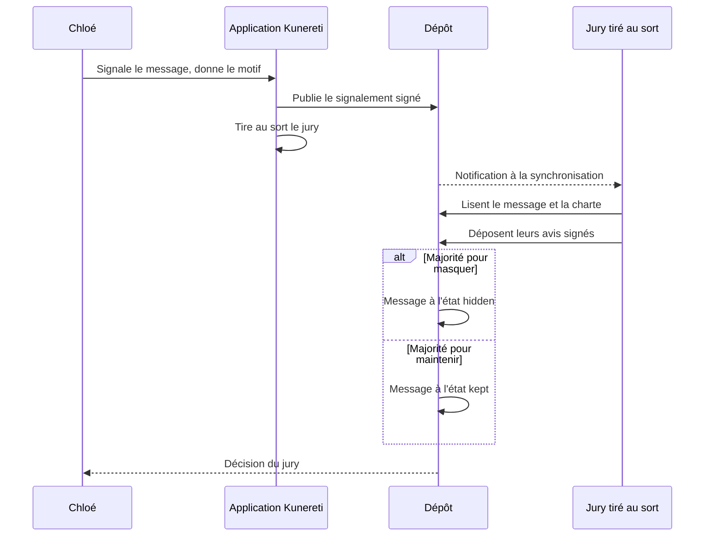

# **Signaler un contenu et le faire juger**

## Résumé
Chloé lit dans un fil un message insultant. Elle le signale. Il n'y a pas de modérateur attitré : un jury est tiré au sort parmi les membres et décide de maintenir le message ou de le masquer. Masquer n'est pas effacer : le message n'est plus affiché, mais il reste dans l'historique.

## Acteurs en jeu
- **Chloé** : la membre qui signale. L'**agent veilleur** peut aussi signaler ; il ne peut jamais masquer.
- **Jury** : des membres tirés au sort.
- **Application Kunereti**.
- **Dépôt** où se trouve le message.

## Prérequis
- La charte définit les motifs de signalement, la taille du jury (trois membres dans KuneAgi), la durée de son examen (sept jours dans KuneAgi) et le nombre de signalements permis à chaque membre par semaine (trois dans KuneAgi).
- Une graine publique est disponible pour le tirage.

## Étapes du scénario
1. Chloé touche « Signaler » sur le message et indique le motif. Si elle a épuisé ses signalements de la semaine, le bouton est inactif.
2. L'application publie un message de signalement signé, qui cite le message visé et porte le motif, transmis tel quel au jury. Le message visé passe à l'état `reported` ; il reste affiché, avec une marque.
3. Le jury est tiré au sort de façon vérifiable (comme au scénario 3), en écartant l'auteur du message et la signaleuse.
4. Les jurés sont notifiés, puis relancés avant l'échéance. Chacun lit le message, son contexte, le motif et la charte.
5. Chaque juré dépose son avis signé : maintenir ou masquer.
6. À l'échéance, ou dès que tous ont répondu : le message est masqué si la majorité des avis exprimés le demande ; il est maintenu sinon, y compris si aucun juré ne s'est prononcé.
7. Si le jury masque : les applications n'affichent plus le texte, mais « Message masqué par décision d'un jury », avec le lien vers la décision. L'auteur, la signaleuse et les jurés sont informés du résultat.
8. Un message maintenu ne peut plus être signalé avant un délai fixé par la charte, sauf s'il a été modifié. L'auteur d'un message masqué peut demander un second jury si la charte le prévoit.

## Diagramme de séquence Mermaid

Ce diagramme illustre une modération sans compte privilégié. Sa limite est à dire clairement : un historique signé et copié ne s'efface pas ; Kunereti ne promet que de ne plus afficher. Le cas d'une égalité des voix n'était pas tranché dans KuneAgi ; il ne l'est pas davantage ici.

Cas d'utilisation : « Discuter ». Retour à l'analyse : [[KR Analyse]].
