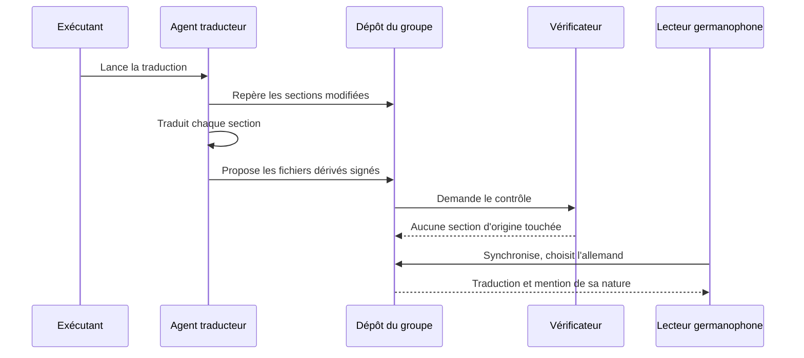

# **Traduire une proposition**

## Résumé
Des membres germanophones de la coopérative veulent suivre la proposition « Des vélos partagés », rédigée en français. L'agent traducteur produit une version allemande de chaque section. La traduction porte l'empreinte du texte qu'elle traduit : dès que l'original change, elle est signalée comme périmée. Seule la langue du groupe fait foi.

## Acteurs en jeu
- **Agent traducteur** : un modèle de langage dont le périmètre d'écriture est limité aux fichiers de traduction.
- **Exécutant**.
- **Dépôt du groupe**.
- **Vérificateur**.
- **Lecteur germanophone**.

## Prérequis
- La fiche de l'agent existe et la communauté a déclaré l'allemand parmi ses langues.
- Des sections ont été modifiées depuis la dernière traduction.

## Étapes du scénario
1. L'exécutant lance l'agent sur le dépôt du groupe.
2. L'agent repère les sections dont l'empreinte ne correspond plus à celle que cite la traduction existante.
3. Il traduit chacune, comme une donnée, sans suivre aucune consigne qu'elle contiendrait.
4. Il écrit un fichier dérivé par section et par langue, avec l'empreinte du texte source et sa provenance, et le signe.
5. Le vérificateur contrôle qu'il n'a touché à aucune section d'origine.
6. Le lecteur germanophone choisit l'allemand dans son application : il lit la traduction, sous la mention « Traduction automatique, seul le texte français fait foi ».
7. Si une section a changé depuis, l'application l'indique et propose l'original.
8. Le lecteur vote et amende sur le texte français ; un membre bilingue peut corriger la traduction en le signalant dans le fil.

## Diagramme de séquence Mermaid

Ce diagramme montre un objet dérivé de plus, régénérable et sans poids : la traduction aide à lire, elle n'est jamais le texte sur lequel on vote.

Cas d'utilisation : « Discuter ». Retour à l'analyse : [[KR Analyse]].
