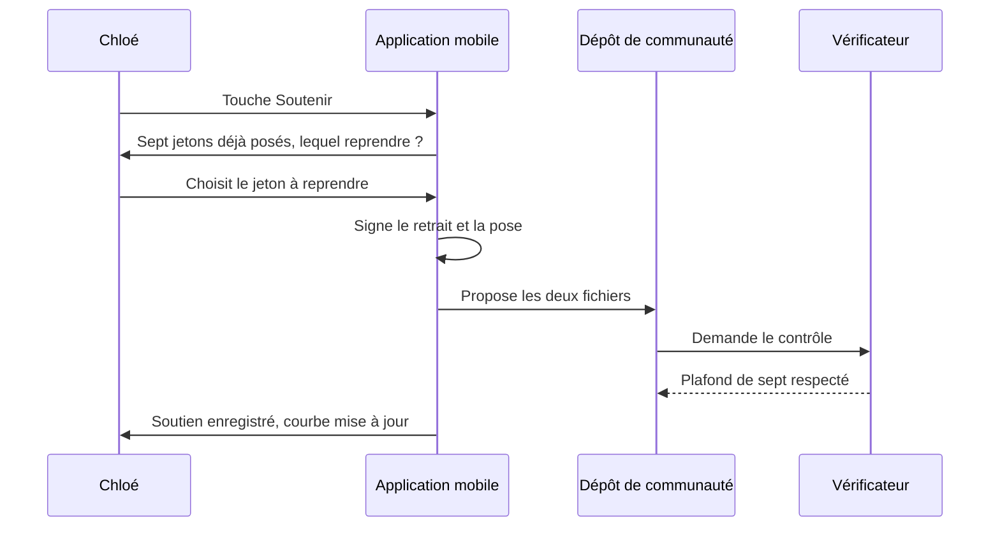

# **Soutenir ou rejeter une proposition**

## Résumé
La proposition « Des vélos partagés » est soumise à la communauté. Chloé veut la soutenir, mais ses sept jetons sont tous posés : elle doit en reprendre un ailleurs pour le placer ici. Poser un jeton, c'est signer. Les déplacements sont conservés, ce qui montre l'évolution des soutiens dans le temps.

## Acteurs en jeu
- **Chloé** : la membre.
- **Application mobile**.
- **Dépôt de communauté** : seul endroit où tous les jetons d'un membre sont visibles ensemble.
- **Vérificateur**.

## Prérequis
- La proposition est à l'état `submitted` (scénario 21).
- Chloé est membre ; la charte lui donne sept jetons.

## Étapes du scénario
1. Chloé ouvre la proposition et touche la flèche de soutien.
2. L'application constate que ses sept jetons sont posés et affiche les sept contenus qui les portent.
3. Chloé choisit de reprendre le jeton posé sur une proposition qui l'intéresse moins.
4. L'application crée deux fichiers signés : le retrait du premier jeton et la pose du nouveau, en soutien.
5. Elle les propose au dépôt de communauté.
6. Le vérificateur contrôle que Chloé n'a jamais plus de sept jetons actifs et qu'elle n'en a qu'un sur ce contenu.
7. Les compteurs de soutien et d'opposition des deux propositions sont recalculés par chaque application.
8. Chloé consulte la courbe des soutiens : la proposition sur les vélos perd des jetons en hiver et les retrouve au printemps.

## Diagramme de séquence Mermaid

Ce diagramme illustre l'astuce sociale conservée de Nova-Ideo : la rareté oblige à arbitrer. L'historique des déplacements fait apparaître les saisonnalités, que le comité de pilotage saura lire (scénario 31).

Cas d'utilisation : « Soutenir et décider ». Retour à l'analyse : [[KR Analyse]].
