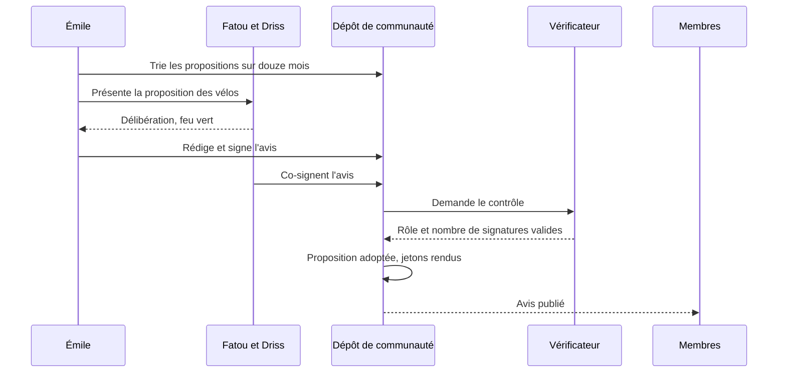

# **Rendre l'avis du comité de pilotage**

## Résumé
Le comité de pilotage se réunit en janvier. Trié par soutien du moment, le classement ignore la proposition sur les vélos, qui a perdu ses jetons avec le froid. Le comité trie sur douze mois, la retrouve, et rend un avis favorable pour l'été. L'avis prend la forme d'un feu tricolore, signé par les membres du comité ; il rend à leurs propriétaires tous les jetons posés sur la proposition.

## Acteurs en jeu
- **Émile, Fatou et Driss** : le comité de pilotage élu (scénario 6).
- **Application Kunereti**.
- **Dépôt de communauté** : porte les jetons et l'avis.
- **Vérificateur**.

## Prérequis
- Des propositions sont à l'état `submitted`.
- Les membres du comité portent ce rôle dans leur fiche, mandat en cours.
- La charte fixe le nombre de signatures exigé pour un avis.

## Étapes du scénario
1. Émile ouvre la liste des propositions soumises et la trie par soutien sur les douze derniers mois.
2. Le comité examine la proposition sur les vélos, ses soutiens, ses oppositions et la synthèse de ses discussions.
3. Il délibère et retient un avis : feu vert, mise en œuvre au printemps.
4. Émile rédige l'avis : la couleur et sa motivation.
5. Fatou et Driss le relisent et le co-signent.
6. L'avis est proposé au dépôt de communauté. Le vérificateur contrôle que les signataires portent le rôle du comité et qu'ils sont assez nombreux.
7. La proposition passe à l'état `examined`, puis `adopted`. Tous les jetons qui la portaient sont rendus à leurs propriétaires. Si le comité avait demandé des compléments, elle serait restée à l'étude, jetons en place, jusqu'à sa réunion suivante (scénario 49).
8. Les membres sont notifiés de l'avis et retrouvent leurs jetons disponibles.

## Diagramme de séquence Mermaid

Ce diagramme montre que le comité n'a pas de compte privilégié : l'avis vaut par les signatures de membres élus, que chacun peut vérifier. Un feu orange ou rouge suit le même chemin, avec une autre issue pour la proposition. Le suivi de la mise en œuvre fait l'objet du scénario 49.

Cas d'utilisation : « Soutenir et décider ». Retour à l'analyse : [[KR Analyse]].
