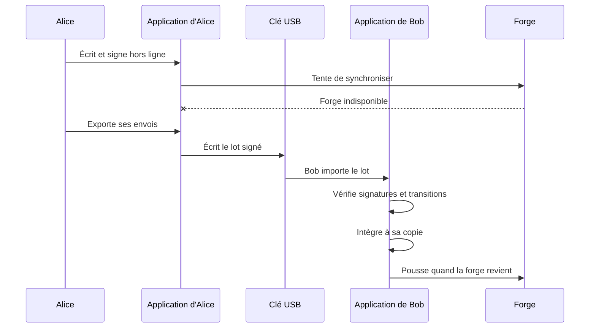

# **Travailler hors ligne et échanger sans forge**

## Résumé
La forge de la communauté est indisponible, et Alice passe trois jours sans réseau. Elle continue de lire, d'écrire et de préparer son vote. À son retour, elle remet ses fichiers signés à Bob sur une clé USB ; Bob les vérifie et les intègre à sa copie. Aucune forge n'était nécessaire.

## Acteurs en jeu
- **Alice** : travaille hors ligne.
- **Bob** : reçoit son travail.
- **Applications** d'Alice et de Bob.
- **Clé USB** : ou tout autre canal, courriel ou messagerie.

## Prérequis
- Alice et Bob ont chacun une copie complète du dépôt du groupe.
- Leurs applications contiennent les scripts de vérification.

## Étapes du scénario
1. Sans réseau, Alice rédige un amendement, répond à deux messages et prépare son bulletin pour le scrutin en cours.
2. Son application signe chaque fichier et les garde en attente.
3. De retour, la forge ne répond toujours pas. Alice choisit « Exporter mes envois ».
4. L'application écrit sur la clé USB un lot contenant ses modifications signées et leur historique.
5. Bob branche la clé et choisit « Importer un lot ».
6. Son application vérifie tout, comme le ferait le vérificateur de la forge : schéma, signatures, appartenance au groupe, légalité des transitions.
7. Les fichiers valides sont intégrés à la copie de Bob. Comme chaque message et chaque bulletin est un fichier distinct, rien n'entre en collision.
8. Quand une forge redevient joignable, le premier des deux qui s'y synchronise y pousse l'ensemble. Le bulletin d'Alice n'est compté que s'il y parvient avant la clôture.

## Diagramme de séquence Mermaid

Ce diagramme illustre ce que veut dire « sans serveur central » : sans serveur applicatif et sans forge imposée. La forge est une commodité ; deux membres peuvent s'échanger un groupe de travail entier de la main à la main.

Cas d'utilisation : « Garantir la confiance sans serveur ». Retour à l'analyse : [[KR Analyse]].
