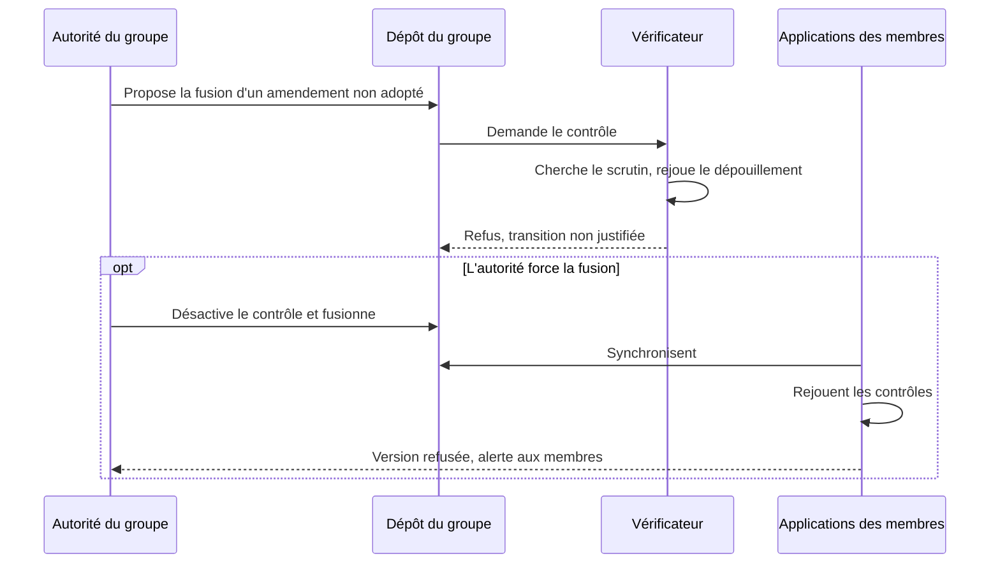

# **Refuser une fusion illégale**

## Résumé
Une autorité du groupe, pressée ou de mauvaise foi, tente de fusionner un amendement que le scrutin n'a pas retenu. Elle détient le bouton de fusion ; elle ne détient pas la décision. Le vérificateur, hébergé hors du dépôt et épinglé, constate qu'aucun scrutin dépouillé ne justifie la transition et refuse. Si l'autorité passe outre, chaque application le voit.

## Acteurs en jeu
- **Vérificateur** : les scripts de contrôle, hébergés hors du dépôt qu'ils contrôlent.
- **Autorité du groupe** : tente la fusion.
- **Dépôt du groupe**.
- **Applications des membres**.

## Prérequis
- Un amendement est à l'état `rejected`, ou `to_vote` sans scrutin dépouillé.
- Le vérificateur est actif sur la forge, dans la version désignée par le manifeste de la communauté.

## Étapes du scénario
1. L'autorité propose une fusion qui fait passer l'amendement à `accepted` et modifie la section.
2. La forge appelle le vérificateur.
3. Le vérificateur lit la définition du processus : cette transition exige un scrutin clos, dépouillé, dont le résultat désigne cet amendement.
4. Il cherche ce scrutin, rejoue son dépouillement et constate que le résultat désigne une autre version.
5. Il refuse la fusion et dit pourquoi : « transition `accepted` non justifiée par un scrutin ».
6. L'autorité, qui administre le dépôt, désactive le contrôle et force la fusion.
7. À leur synchronisation, les applications des membres rejouent les mêmes contrôles : elles refusent la version forcée, restent sur la dernière version légale et alertent leurs propriétaires.
8. Les membres demandent la révocation de l'autorité (scénario 6) ou poursuivent sur un autre miroir du dépôt.

## Diagramme de séquence Mermaid

Ce diagramme montre que la légitimité vient des signatures, pas de l'hébergement. Le vérificateur de la forge est un premier filet ; le filet de fond est que chaque membre contrôle lui-même ce qu'il reçoit.

Cas d'utilisation : « Garantir la confiance sans serveur ». Retour à l'analyse : [[KR Analyse]].
