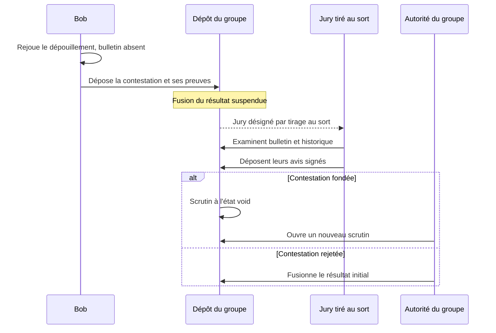

# **Contester un scrutin**

## Résumé
Bob a voté à temps, mais son bulletin ne figure pas dans la liste figée à la clôture. Il n'y a pas d'horloge commune ni d'urne centrale pour trancher. Bob produit ses preuves : son bulletin signé et l'historique de sa copie. Un jury tiré au sort examine la contestation et annule le scrutin, qui est rouvert.

## Acteurs en jeu
- **Bob** : le votant écarté.
- **Jury** : des membres tirés au sort.
- **Dépôt du groupe**.
- **Autorité du groupe**.

## Prérequis
- Un scrutin est clos et dépouillé.
- Bob détient un bulletin signé pour ce scrutin, absent de la liste figée à la clôture.
- La charte fixe le délai de contestation.

## Étapes du scénario
1. Bob constate, en rejouant le dépouillement, que son bulletin n'a pas été compté.
2. Il dépose une contestation signée : son bulletin, et l'historique de sa copie montrant qu'il avait été envoyé avant la clôture.
3. La fusion du résultat est suspendue pendant le délai de contestation.
4. Un jury est tiré au sort de façon vérifiable, hors des participants au scrutin si la taille de la communauté le permet.
5. Le jury examine les preuves : le bulletin est valide, et son absence pouvait changer le résultat.
6. Les jurés déposent leurs avis signés ; la majorité annule.
7. Le scrutin passe à l'état `void`. Un nouveau scrutin est ouvert sur les mêmes candidats, avec le même corps électoral.
8. Si le bulletin n'avait pas pu changer le résultat, le jury aurait pu maintenir le scrutin en le faisant consigner.

## Diagramme de séquence Mermaid

Ce diagramme illustre la réponse de Kunereti à l'absence d'horloge commune : la clôture fige une liste, et celui qui en est exclu à tort dispose de preuves publiables. C'est plus lourd qu'un horodatage central, et c'est le prix de son absence.

Cas d'utilisation : « Garantir la confiance sans serveur ». Retour à l'analyse : [[KR Analyse]].
