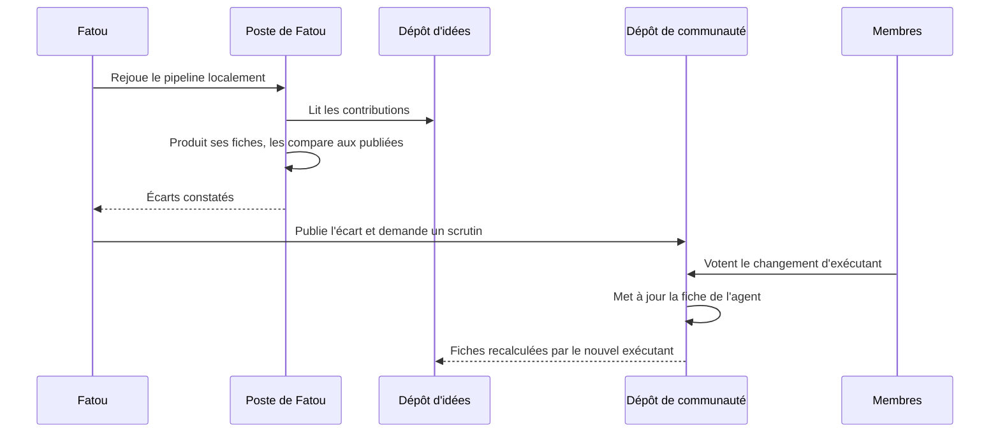

# **Rejouer le pipeline d'idées et changer d'exécutant**

## Résumé
Fatou soupçonne l'agent curateur de mal regrouper les idées depuis que son exécutant a changé de modèle. Le pipeline est rejouable par n'importe qui : elle le lance sur son poste, avec le modèle de son choix, compare ses fiches à celles qui sont publiées et publie l'écart. La communauté vote alors le changement d'exécutant.

## Acteurs en jeu
- **Fatou** : la membre qui contrôle.
- **Poste de Fatou** : exécute le pipeline localement.
- **Dépôt d'idées** et **dépôt de communauté**.
- **Les membres** : ils votent.

## Prérequis
- Fatou a cloné le dépôt d'idées.
- Elle dispose d'un modèle de langage, local ou distant.
- Les consignes du pipeline sont publiées dans le dépôt de communauté.

## Étapes du scénario
1. Fatou lance le pipeline sur les contributions publiées, sans rien écrire dans le dépôt partagé.
2. Son poste produit un jeu de fiches d'idées.
3. Il le compare au jeu publié : fiches regroupées différemment, citations manquantes, idées absentes.
4. Deux modèles ne produisent jamais les mêmes fiches ; Fatou cherche les écarts qui comptent. Elle en trouve un : douze contributions sur les vélos cargo ne sont citées par aucune fiche publiée.
5. Elle publie un message qui expose l'écart, avec la provenance de son propre calcul.
6. Elle demande un scrutin : désigner un autre exécutant, ou revenir au modèle précédent.
7. La communauté vote (scénario 5). La fiche de l'agent est mise à jour : nouvel exécutant, nouvelle clé, ancienne clé révoquée.
8. Le nouvel exécutant efface les fiches et les recalcule depuis les contributions, qui n'ont pas bougé.

## Diagramme de séquence Mermaid

Ce diagramme montre que changer de modèle ou d'exécutant est une décision votée, pas une migration. Il n'est tenable que parce que les fiches d'idées sont dérivées et sans poids : le jour où l'on voudrait voter sur une idée, tout ce raisonnement tomberait.

Cas d'utilisation : « Garantir la confiance sans serveur ». Retour à l'analyse : [[KR Analyse]].
