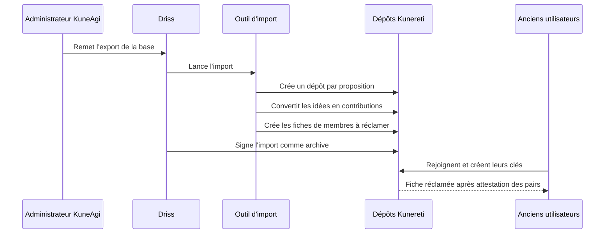

# **Importer une instance KuneAgi**

## Résumé
La coopérative utilisait une instance KuneAgi. Driss veut reprendre son contenu dans Kunereti. L'administrateur exporte la base ; un outil d'import convertit les propositions en dépôts de groupes et les idées en contributions. Ce qui a été fait sur le serveur n'a jamais été signé : il est importé comme une archive, attestée par l'autorité qui importe, et les membres doivent créer leurs clés pour continuer.

## Acteurs en jeu
- **Driss** : autorité de la communauté Kunereti.
- **Administrateur** de l'instance KuneAgi.
- **Outil d'import**.
- **Dépôts Kunereti** : communauté, idées, groupes.
- **Les anciens utilisateurs**.

## Prérequis
- La communauté Kunereti est fondée (scénario 1).
- L'instance KuneAgi dispose de l'export complet de sa base objet, prévu par le plan de modernisation.
- Les utilisateurs ont été informés et ont pu s'opposer à la reprise de leurs contenus.

## Étapes du scénario
1. L'administrateur produit l'export de la base : contenus, états, votes, jetons, comptes.
2. Driss lance l'outil d'import sur cet export.
3. Chaque proposition devient un dépôt de groupe : le texte est découpé en sections, les versions successives deviennent l'historique, les amendements et les messages deviennent des fichiers.
4. Les idées de l'ancien système deviennent des contributions ; le curateur recalculera les fiches.
5. Chaque compte devient une fiche de membre sous pseudonyme, sans clé et sans aucune donnée d'identité, à l'état « à réclamer ».
6. Les scrutins et les jetons passés sont importés comme des résultats historiques. Faute de bulletins signés, ils ne sont pas rejouables : l'import entier est signé par Driss, qui atteste sa conformité à l'export.
7. Les dépôts sont publiés et recensés.
8. Chaque ancien utilisateur rejoint la communauté (scénario 2) et réclame sa fiche ; des pairs tirés au sort attestent qu'il en est bien le titulaire. Les processus en cours repartent à l'ouverture d'une nouvelle itération.

## Diagramme de séquence Mermaid

Ce diagramme montre que Kunereti ne dispense pas de la modernisation de KuneAgi : c'est l'export de la base, prévu par celle-ci, qui rend la reprise possible. Il montre aussi sa limite : le passé importé repose sur la parole de celui qui importe, contrairement à tout ce qui sera fait ensuite.

Cas d'utilisation : « Garantir la confiance sans serveur ». Retour à l'analyse : [[KR Analyse]].
