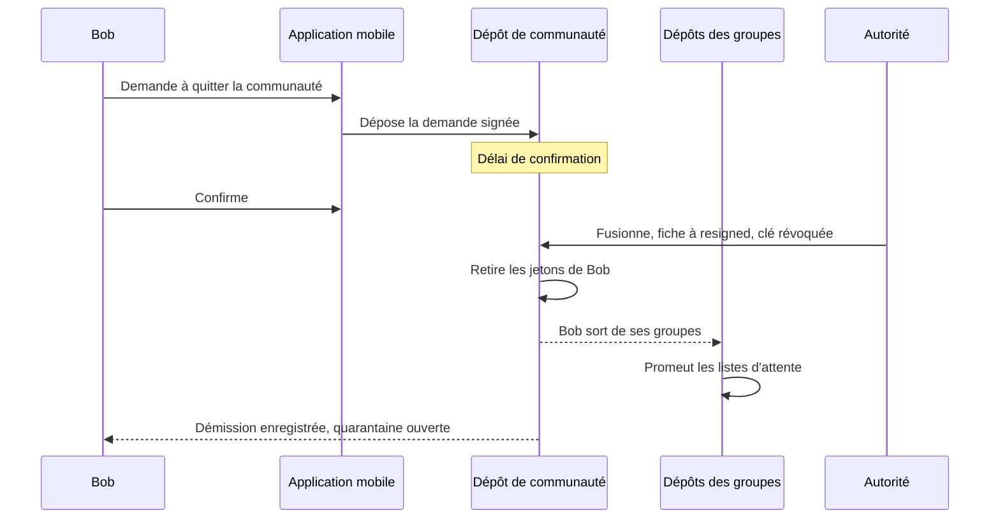

# **Quitter la communauté**

## Résumé
Bob quitte la Coopérative des Tilleuls. Il confirme sa démission après un délai de réflexion ; sa clé est révoquée, il sort de ses groupes et ses jetons sont retirés. Ce qu'il a écrit reste attribué à son pseudonyme : un historique signé et copié ne s'efface pas. Une quarantaine l'empêche de revenir aussitôt sous une identité vierge.

## Acteurs en jeu
- **Bob** : le membre qui démissionne.
- **Application mobile**.
- **Dépôt de communauté** et **dépôts des groupes** de Bob.
- **Autorité** : fusionne la démission.

## Prérequis
- Bob est membre.
- La charte fixe le délai de confirmation (deux jours dans KuneAgi) et la durée de la quarantaine (six mois dans KuneAgi, dès les spécifications de 2011).
- Bob a été prévenu, à son admission, que ses publications ne pourraient pas être effacées.

## Étapes du scénario
1. Bob choisit « Quitter la communauté ». L'application lui rappelle ce qui va se passer et ce qui ne peut pas être défait.
2. Elle dépose une demande de démission signée. Bob dispose du délai de confirmation pour changer d'avis ; sans confirmation, la demande est annulée.
3. Bob confirme. Sa fiche passe à l'état `resigned` et sa clé est révoquée, avec la date.
4. Il est retiré de ses groupes de travail ; la première personne de chaque liste d'attente prend sa place (scénario 15).
5. Ses jetons sont retirés. Ses bulletins des scrutins déjà clos restent comptés ; ceux des scrutins ouverts sont écartés.
6. Ses contributions, messages et amendements restent dans l'historique, attribués à son pseudonyme, que les applications affichent désormais comme « ancien membre ».
7. Sa fiche garde la date de fin de quarantaine : avant cette date, une candidature de la même personne est refusée par les membres vérificateurs. La quarantaine empêche qu'un membre mal apprécié de ses pairs revienne aussitôt avec une réputation vierge (scénario 45).
8. Bob supprime l'application ; ses clés privées disparaissent avec elle.

## Diagramme de séquence Mermaid

Ce diagramme illustre la démission en deux temps de KuneAgi, transposée. Il met au jour la difficulté la plus sérieuse du projet face au droit à l'effacement : KuneAgi réattribuait les contenus à « Anonyme » et effaçait l'identité après la quarantaine ; Kunereti ne peut que rompre le lien entre le pseudonyme et la personne, puisqu'il ne stocke aucune identité. Faire respecter la quarantaine sans registre d'identités reste à concevoir.

Cas d'utilisation : « Faire vivre la communauté ». Retour à l'analyse : [[KR Analyse]].
