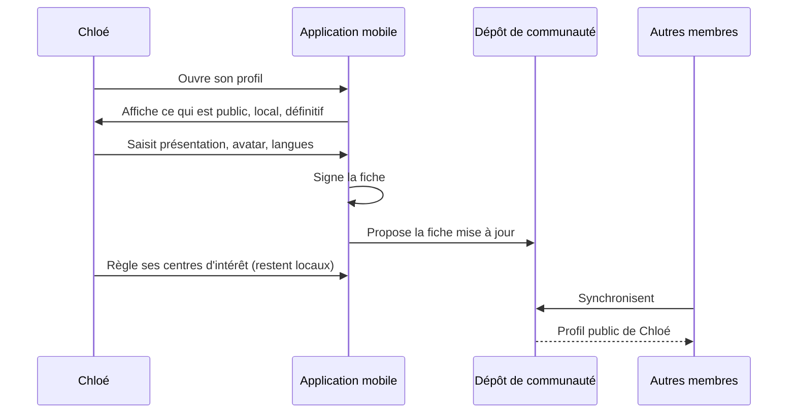

# **Gérer son profil**

## Résumé
Chloé complète son profil. Les autres membres ne voient que ce que porte sa fiche : son pseudonyme, un texte de présentation, un avatar, ses langues, ses rôles et ses groupes. Ses centres d'intérêt et ses réglages restent sur son téléphone. Elle peut choisir de lever son pseudonymat, par exemple pour se porter candidate à un comité.

## Acteurs en jeu
- **Chloé** : la membre.
- **Application mobile**.
- **Dépôt de communauté** : porte la fiche de membre.

## Prérequis
- Chloé est membre.
- Son pseudonyme, choisi à la candidature, est définitif.

## Étapes du scénario
1. Chloé ouvre « Mon profil ».
2. L'application distingue trois zones : ce que tous voient, ce qui reste sur l'appareil, ce qui ne peut plus changer (le pseudonyme).
3. Chloé rédige son texte de présentation (expérience, compétences) et choisit un avatar.
4. Elle indique de une à trois langues d'interaction, dans l'ordre de préférence ; l'application s'en servira pour lui proposer les traductions (scénario 29).
5. Elle enregistre : l'application signe la nouvelle version de sa fiche et la propose au dépôt de communauté.
6. Elle règle ses centres d'intérêt et ses abonnements (scénario 42) ; rien de cela ne quitte son téléphone.
7. Chloé décide de se présenter au comité de pilotage : elle choisit de publier son nom dans sa fiche. L'application l'avertit que ce choix ne pourra pas être effacé de l'historique.
8. Les autres membres voient le profil mis à jour à leur synchronisation, avec ses rôles et ses groupes, lus dans les dépôts.

## Diagramme de séquence Mermaid

Ce diagramme montre que le pseudonymat est la règle, comme dans KuneAgi depuis 2017, et que sa levée est un acte volontaire. Il n'y a pas d'adresse de courriel à masquer : la communauté n'en connaît aucune.

Cas d'utilisation : « Faire vivre la communauté ». Retour à l'analyse : [[KR Analyse]].
