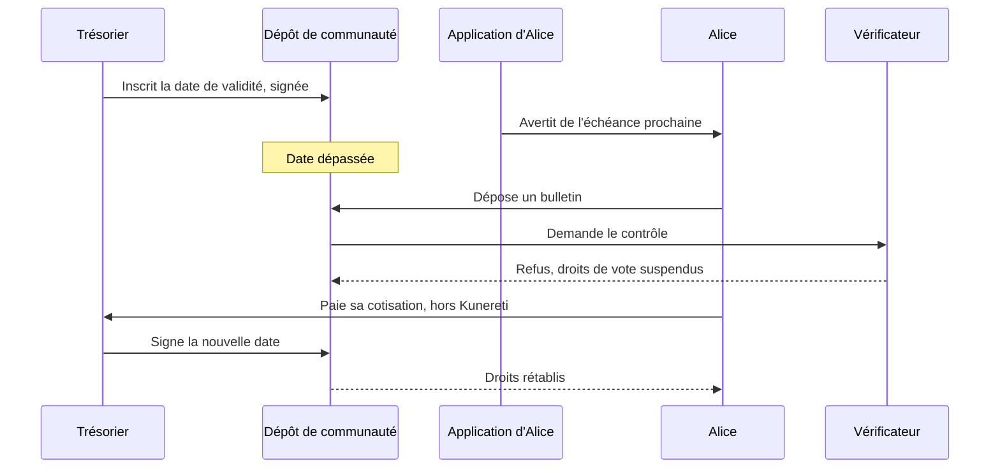

# **Suspendre et rétablir les droits d'un membre**

## Résumé
La Coopérative des Tilleuls réserve le vote aux membres à jour de leur cotisation. Celle d'Alice est échue : ses droits de vote sont suspendus, puis rétablis dès qu'elle a payé. Rien de cela n'est automatique au sens d'un serveur : la date de validité est inscrite dans la fiche d'Alice par le trésorier élu, et chaque application en tire la conséquence.

## Acteurs en jeu
- **Trésorier** : membre élu à ce rôle (scénario 6).
- **Alice** : la membre concernée.
- **Dépôt de communauté** : porte les fiches de membres.
- **Applications** et **vérificateur**.

## Prérequis
- La charte définit les statuts de membre et leurs conditions : par exemple membre ordinaire, qui contribue et discute, et coopérateur, qui vote, à condition de détenir une part et d'être à jour de sa cotisation annuelle.
- Le paiement a lieu hors de Kunereti.
- Le rôle de trésorier a été pourvu par scrutin.

## Étapes du scénario
1. À l'encaissement de la cotisation d'Alice, le trésorier avait inscrit dans sa fiche la date de fin de validité, sous sa signature.
2. Quelques semaines avant cette date, l'application d'Alice l'en avertit.
3. La date passe sans renouvellement. Aucun acte n'est nécessaire : toutes les applications et le vérificateur lisent la date et cessent d'accepter les bulletins d'Alice. Elle n'est plus inscrite dans le corps électoral des scrutins qui s'ouvrent.
4. Alice continue de lire, de contribuer et de discuter. Si elle exerce un mandat, il est suspendu, pas perdu.
5. Elle paie sa cotisation. Le trésorier signe la nouvelle date dans sa fiche.
6. À la synchronisation suivante, Alice vote de nouveau ; son mandat est rétabli.
7. Une sanction suit le même chemin, avec une autre origine : elle est prononcée par l'instance de médiation élue, et inscrite dans la fiche avec sa date de fin.
8. Un membre ordinaire qui veut devenir coopérateur garde son pseudonyme et passe la vérification d'identité (scénario 3).

## Diagramme de séquence Mermaid

Ce diagramme illustre les statuts gradués apparus avec AlirPunkto en 2023. Le « balayage quotidien » d'un serveur devient une date que chacun lit. Toutes les communautés n'en ont pas besoin : c'est une option de la charte.

Cas d'utilisation : « Faire vivre la communauté ». Retour à l'analyse : [[KR Analyse]].
