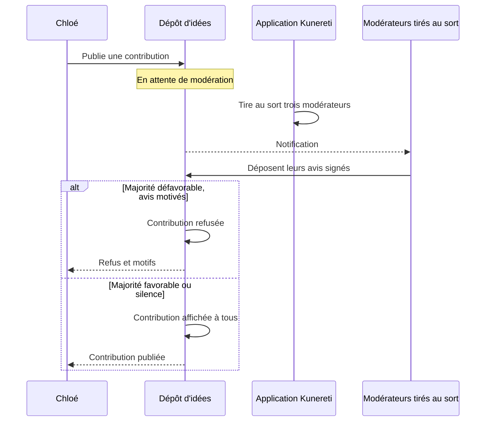

# **Modérer une contribution avant sa publication**

## Résumé
La charte des Tilleuls prévoit que tout nouveau contenu est relu avant d'être affiché. La contribution de Chloé est soumise à trois membres tirés au sort. Ils ne jugent pas le fond, seulement le respect des personnes et de la charte. S'ils ne disent rien, la contribution est publiée. Un refus doit citer le passage en cause et la règle enfreinte.

## Acteurs en jeu
- **Trois membres tirés au sort** : les modérateurs.
- **Chloé** : l'auteure.
- **Application Kunereti**.
- **Dépôt d'idées**.

## Prérequis
- La charte active la modération avant publication et en fixe le nombre de modérateurs (trois dans KuneAgi) et la durée (quinze jours dans les spécifications de 2011, sept jours dans KuneAgi en 2017).
- Chloé vient de publier une contribution (scénario 8).

## Étapes du scénario
1. La contribution de Chloé entre dans le dépôt à l'état « en attente de modération ». Les applications ne l'affichent qu'à son auteure et aux modérateurs.
2. Trois modérateurs sont tirés au sort de façon vérifiable (comme au scénario 3), hors de l'auteure.
3. Ils sont notifiés ; un rappel leur parvient avant l'échéance.
4. Chacun lit la contribution et dépose un avis signé : conforme ou non conforme.
5. Un avis « non conforme » n'est accepté que s'il cite l'extrait du texte et l'extrait de la charte qu'il enfreint.
6. À l'échéance, ou dès que les trois ont répondu : la contribution est refusée si la majorité des avis exprimés est défavorable ; elle est publiée sinon, y compris si personne ne s'est prononcé.
7. Chloé est notifiée du résultat et, en cas de refus, des motifs. Les avis sont publics ; les modérateurs y sont désignés « Modérateur 1, 2, 3 ».
8. Une contribution refusée reste dans l'historique sans être affichée. Chloé peut en publier une nouvelle version.

## Diagramme de séquence Mermaid

Ce diagramme montre la modération répartie de KuneAgi, distincte du signalement, qui intervient après coup (scénario 28). Le silence vaut ici approbation, alors qu'il vaut refus pour une admission (scénario 3) : le doute profite à l'expression, pas à l'entrée d'un inconnu. Reste à trancher : comment désigner les modérateurs par un numéro quand leurs avis sont signés, et que faire en cas d'égalité.

Cas d'utilisation : « Recueillir les contributions et tenir les idées ». Retour à l'analyse : [[KR Analyse]].
