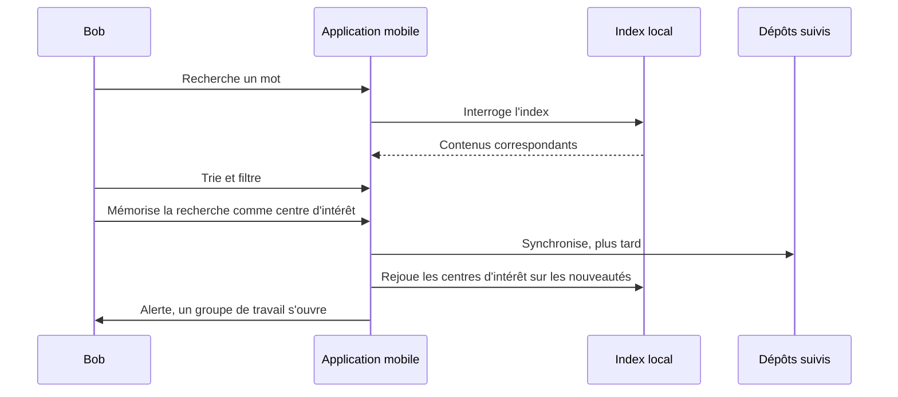

# **Rechercher et suivre ses centres d'intérêt**

## Résumé
Bob cherche ce qui s'est dit sur le stationnement. Il interroge l'index que son application tient sur son téléphone, trie les résultats, les filtre, puis mémorise sa recherche comme centre d'intérêt. Désormais, son application l'alertera quand une idée, un appel ou un groupe de travail y répondra.

## Acteurs en jeu
- **Bob** : le membre.
- **Application mobile** : tient l'index local.
- **Dépôts suivis**.

## Prérequis
- Bob a synchronisé les dépôts de la communauté.
- L'index local a été construit à partir des en-têtes des fichiers.

## Étapes du scénario
1. Bob saisit « stationnement » dans la recherche.
2. L'application interroge son index local et affiche idées, propositions, questions et messages qui en parlent.
3. Bob trie : par date, par soutien, par titre.
4. Il filtre : par type de contenu, par période, par auteur, par appel à idées, par état.
5. Il enregistre la recherche comme centre d'intérêt, « Stationnement et vélos ».
6. Il choisit d'être alerté pour les nouveaux groupes de travail et les propositions soumises qui y répondent.
7. À chaque synchronisation, l'application rejoue ses centres d'intérêt sur les nouveautés et ajoute les résultats à ses notifications (scénario 25).
8. La recherche et les centres d'intérêt ne quittent pas le téléphone de Bob.

## Diagramme de séquence Mermaid

Ce diagramme illustre les « centres d'intérêt » des spécifications de 2011, qui étaient déjà des requêtes mémorisées. La différence est leur emplacement : ils ne sont plus sur un serveur, donc personne ne peut dresser le portrait des curiosités de Bob.

Cas d'utilisation : « Recueillir les contributions et tenir les idées ». Retour à l'analyse : [[KR Analyse]].
