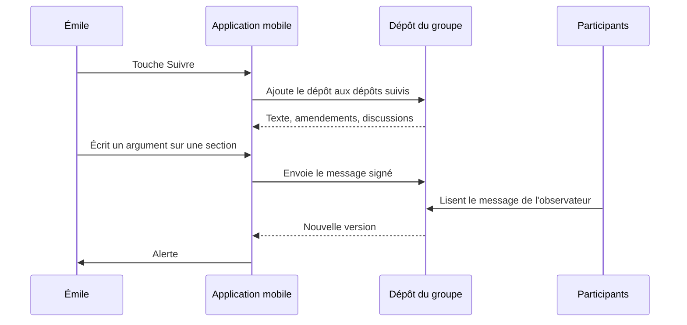

# **Suivre un groupe en observateur**

## Résumé
Émile s'intéresse à la proposition « Des vélos partagés » mais ne veut pas, ou ne peut pas, rejoindre le groupe. Il le suit en observateur : il lit le texte, les amendements et les discussions, apporte des arguments que le groupe prend en compte librement, et est alerté à chaque nouvelle version. Il ne vote pas.

## Acteurs en jeu
- **Émile** : l'observateur.
- **Application mobile**.
- **Dépôt du groupe**.
- **Les participants** du groupe.

## Prérequis
- Émile est membre.
- Le dépôt du groupe lui est lisible (groupe ouvert à la communauté).
- Les observateurs sont en nombre illimité ; toute personne en liste d'attente est observatrice.

## Étapes du scénario
1. Émile ouvre la proposition et touche « Suivre ».
2. Son application ajoute le dépôt du groupe à ses dépôts suivis. Ce choix n'est inscrit nulle part ailleurs.
3. Il lit le texte en cours, les amendements soumis et leur justification.
4. Il écrit un message sur une section : une information que le groupe n'avait pas. Son message est signé ; les applications le présentent comme venant d'un observateur.
5. Les participants en tiennent compte, ou non.
6. Une fois la proposition soumise à la communauté, Émile peut donner un retour plus structuré : dire quelle modification le ferait soutenir, ou retirer son soutien.
7. Il est alerté à chaque nouvelle version et à l'ouverture de chaque scrutin, auquel il ne participe pas.
8. S'il veut peser, il demande à participer (scénario 15).

## Diagramme de séquence Mermaid

Ce diagramme montre le rôle d'observateur des spécifications de KuneAgi. Il règle une tension du petit groupe : douze personnes décident, mais tous peuvent voir et nourrir le débat.

Cas d'utilisation : « Co-écrire une proposition en groupe de travail ». Retour à l'analyse : [[KR Analyse]].
