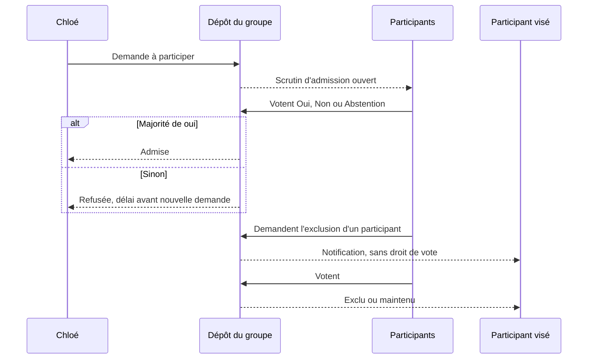

# **Admettre ou exclure un participant par un vote du groupe**

## Résumé
Le groupe « Des vélos partagés » a choisi de contrôler sa composition. Quand Chloé demande à y entrer, les participants votent. Plus tard, un participant qui sabote le travail fait l'objet d'un vote d'exclusion, auquel il ne prend pas part. Une décision prise vaut pour une durée fixée : on ne revote pas la même chose le lendemain.

## Acteurs en jeu
- **Les participants** : ils votent.
- **Chloé** : candidate à l'entrée.
- **Le participant visé** par l'exclusion.
- **Dépôt du groupe**.

## Prérequis
- Le groupe a retenu l'un des modes de contrôle de sa composition : à l'entrée, à la sortie, ou les deux. Sans cela l'entrée est libre (scénario 15).
- La charte fixe la durée du vote (sept jours dans les spécifications de 2011) et la durée de validité des décisions.
- Le groupe a choisi son mode de décision : majorité simple des votes exprimés par défaut ; les spécifications de 2011 offraient aussi la majorité qualifiée (deux tiers des exprimés, avec un quorum des deux tiers des participants), l'unanimité et le consensus.

## Étapes du scénario
1. Chloé demande à participer. Sa demande ouvre un scrutin Oui / Non / Abstention parmi les participants.
2. Les participants consultent son profil et, si la communauté l'a activée, sa note de comportement coopératif (scénario 45).
3. À l'échéance : Chloé est admise si les oui l'emportent parmi les votes exprimés, selon le mode de décision du groupe ; elle est refusée sinon. L'abstention est la valeur par défaut, et le refus le résultat par défaut.
4. Refusée, elle ne peut pas redemander l'entrée dans ce groupe avant la fin de la durée de validité de la décision. Elle peut suivre le groupe en observatrice (scénario 43) ou partir d'une copie (scénario 22).
5. Plus tard, Bob demande l'exclusion d'un participant, en exposant ses raisons dans un message.
6. Un scrutin est ouvert. Le participant visé est notifié ; il ne vote pas, mais il peut répondre.
7. Si les oui l'emportent, le participant est retiré du groupe ; son travail passé reste dans l'historique. La première personne de la liste d'attente prend sa place.
8. S'il est maintenu, une nouvelle demande d'exclusion contre lui est refusée pendant la durée de validité de la décision.

## Diagramme de séquence Mermaid

Ce diagramme illustre le « double contrôle de composition » de KuneAgi. La durée de validité des décisions empêche le harcèlement par votes répétés. Et l'exclu garde toujours une issue que le serveur central ne lui offrait pas : repartir d'une copie.

Cas d'utilisation : « Co-écrire une proposition en groupe de travail ». Retour à l'analyse : [[KR Analyse]].
