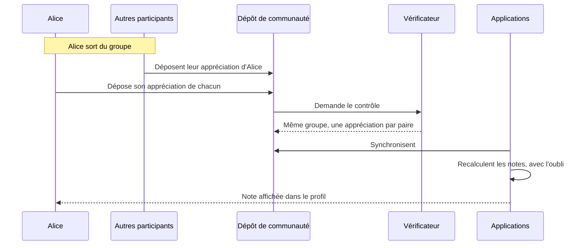

# **Apprécier ses pairs à la sortie d'un groupe**

## Résumé
Alice quitte le groupe « Des vélos partagés », dont le travail est achevé. Chaque participant apprécie alors le comportement coopératif des autres : meilleur qu'attendu, conforme, ou inférieur. Les appréciations nourrissent une note visible dans le profil de chacun, qui s'efface avec le temps. C'est une option que la communauté active ou non.

## Acteurs en jeu
- **Alice** : la participante qui sort.
- **Les autres participants**.
- **Applications**.
- **Dépôt de communauté** : reçoit les appréciations.

## Prérequis
- La charte a activé la note de comportement coopératif et fixé sa vitesse d'oubli (demi-vie de 180 jours dans KuneAgi).
- Un participant cesse de l'être, quelle qu'en soit la raison : fin du groupe, départ, exclusion.

## Étapes du scénario
1. Alice sort du groupe. Les applications des autres participants leur proposent de l'apprécier, et celle d'Alice de les apprécier tous. Quand c'est le groupe entier qui se dissout, chacun apprécie tous les autres.
2. Chacun attribue +1 (meilleur qu'attendu), 0 (conforme à ce qu'on attend) ou −1 (inférieur). Il n'apprécie que le comportement dans le travail commun, pas les opinions.
3. Chaque appréciation est un fichier signé, déposé dans le dépôt de communauté.
4. Le vérificateur contrôle que l'auteur et la personne appréciée ont bien été participants du même groupe, et qu'il n'y a qu'une appréciation par paire et par groupe.
5. La note d'un membre est un calcul que chaque application refait : la somme de ses appréciations, chacune comptant de moins en moins à mesure qu'elle vieillit.
6. La note et sa date s'affichent dans le profil. Un groupe qui contrôle sa composition la consulte avant d'admettre un candidat (scénario 44).
7. Deux communautés reliées (scénario 7) peuvent convenir de lire les appréciations l'une de l'autre.
8. Une communauté qui renonce à la note cesse de l'afficher ; les fichiers restent dans l'historique.

## Diagramme de séquence Mermaid

Ce diagramme montre la « note de comportement coopératif » demandée dès 2011 et précisée en 2016. Elle est délicate à transposer : dans KuneAgi le serveur cachait qui avait noté qui ; ici chaque appréciation est signée, donc attribuable. Faut-il la sceller, l'agréger avant de la publier, ou y renoncer ? La question est ouverte, et l'oubli lui-même n'est qu'un calcul : les fichiers demeurent. Les spécifications de 2011 notaient deux choses, la qualité technique et le comportement coopératif ; KuneAgi n'a gardé en 2016 que la seconde.

Cas d'utilisation : « Co-écrire une proposition en groupe de travail ». Retour à l'analyse : [[KR Analyse]].
