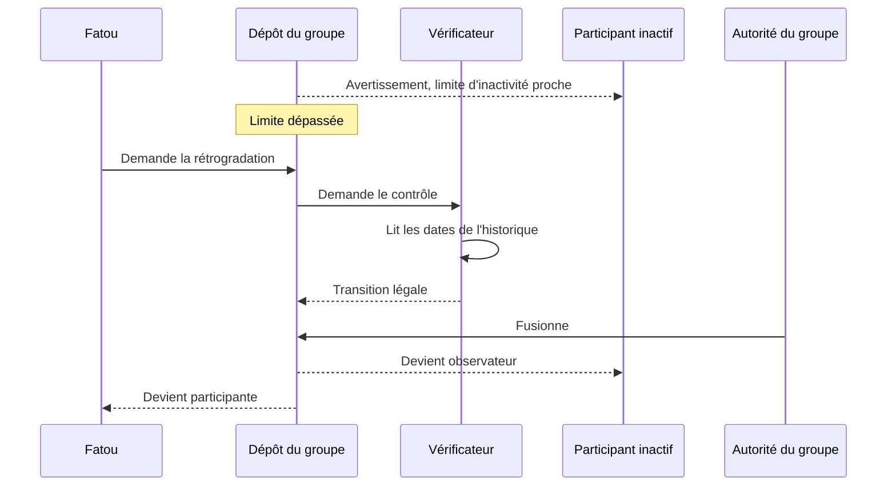

# **Constater l'inactivité d'un participant ou d'un groupe**

## Résumé
Dans KuneAgi, une minuterie du serveur évinçait les participants inactifs et dissolvait les groupes qui ne produisaient plus rien. Sans serveur, personne ne déclenche rien tout seul : les échéances sont des dates que tous peuvent lire dans l'historique. N'importe quel membre constate qu'une échéance est dépassée et demande la transition, qui n'est légale que si les dates la justifient.

## Acteurs en jeu
- **Fatou** : sur liste d'attente du groupe, elle constate l'inactivité.
- **Le participant inactif**.
- **Autorité du groupe**.
- **Dépôt du groupe** et **vérificateur**.

## Prérequis
- La charte fixe les durées. Les spécifications de KuneAgi de 2011 proposaient : trente jours d'inactivité tolérée pour un participant, soixante jours sans nouvelle version pour un groupe, soixante jours de recrutement infructueux, cent quatre-vingts jours sous le seuil de soutiens pour une proposition soumise, et un avertissement quinze jours avant chaque échéance.
- Est une contribution au sens de l'activité : une modification, un amendement, un message, un bulletin.

## Étapes du scénario
1. Quinze jours avant la limite, les applications avertissent d'elles-mêmes le participant qu'il approche de la limite d'inactivité : il a le temps de l'éviter.
2. La limite passe. Fatou, première de la liste d'attente, le constate et demande la rétrogradation du participant.
3. Le vérificateur lit l'historique : aucun fichier signé par ce participant depuis la durée fixée. La transition est légale.
4. Le participant devient observateur ; Fatou prend sa place. Il peut redemander à participer. Si la communauté a activé l'appréciation des pairs, elle a lieu à ce moment (scénario 45).
5. Si le départ fait passer le groupe sous son nombre minimal de participants, la proposition revient à l'état `open` : le groupe recrute de nouveau, et le travail reprend quand le seuil est atteint.
6. De la même façon, un groupe qui n'a produit aucune nouvelle version pendant la durée fixée reçoit un avertissement, puis peut être dissous à la demande de tout membre : la proposition passe à l'état archivé.
7. Une proposition soumise dont les soutiens restent sous le seuil pendant la durée fixée est retirée de la liste des propositions à examiner ; ceux qui la soutenaient en sont avertis avant.
8. Rien n'est perdu : une proposition archivée peut être réactivée par un nouveau groupe, ou reprise par copie (scénario 22).
9. Si personne ne demande la transition, il ne se passe rien : un groupe endormi ne gêne personne.
10. La même question se pose pour la communauté entière : un membre qui n'a plus rien signé depuis longtemps (quatre-vingt-dix jours sans connexion dans les spécifications de 2011) ne devrait plus être tiré au sort ni compter dans les quorums. À décider dans la charte.

## Diagramme de séquence Mermaid

Ce diagramme illustre la réponse à une question que le serveur rendait invisible : qui fait tourner l'horloge ? Personne. Une échéance est un fait vérifiable, et c'est celui qui y a intérêt qui la fait constater.

Cas d'utilisation : « Co-écrire une proposition en groupe de travail ». Retour à l'analyse : [[KR Analyse]].
