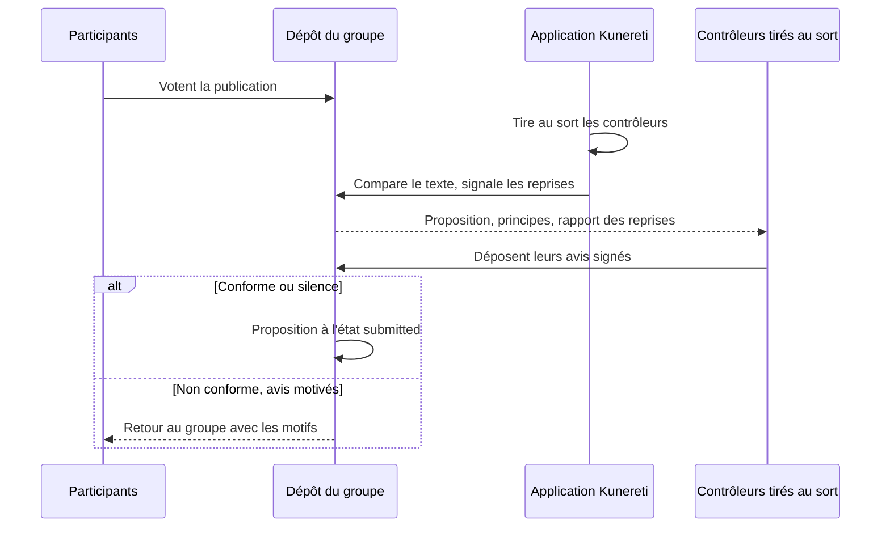

# **Contrôler la conformité d'une proposition avant sa soumission**

## Résumé
Le groupe a voté la publication de sa proposition. Avant qu'elle soit soumise au soutien de tous, des membres tirés au sort contrôlent deux choses : qu'elle respecte les principes de la communauté, et qu'elle cite les textes dont elle reprend des passages. Ils ne jugent pas l'opportunité de la proposition : cela, ce sont les jetons et le comité qui le diront.

## Acteurs en jeu
- **Membres tirés au sort** : les contrôleurs.
- **Application Kunereti** : prépare le contrôle des reprises.
- **Dépôt du groupe**.
- **Les participants** du groupe.

## Prérequis
- La charte active ce contrôle, énonce les principes de la communauté et fixe le nombre de contrôleurs et la durée du contrôle (cinq contrôleurs et quinze jours dans les spécifications de 2011).
- Le groupe a voté « publier » (scénario 21).

## Étapes du scénario
1. Le vote de publication ouvre le contrôle : la proposition n'est pas encore visible de toute la communauté.
2. Les contrôleurs sont tirés au sort, hors des participants du groupe.
3. L'application compare le texte aux propositions publiées et à l'historique du dépôt : elle signale les passages repris d'ailleurs et vérifie que leur origine est citée. C'est un calcul sur les textes.
4. Chaque contrôleur lit la proposition, les principes et le rapport des reprises.
5. Il dépose un avis signé. Un avis défavorable doit citer le passage en cause et le principe enfreint, ou le texte repris sans attribution.
6. À l'échéance : la proposition est soumise si la majorité des avis exprimés est favorable ou si personne ne s'est prononcé.
7. En cas de refus, la proposition revient au groupe avec les motifs ; une nouvelle itération peut la corriger.
8. Acceptée, elle passe à l'état `submitted` et reçoit ses premiers jetons (scénario 30).

## Diagramme de séquence Mermaid

Ce diagramme montre le second contrôle réparti des spécifications de KuneAgi, placé avant la diffusion. L'obligation de citer ce qu'on reprend est déjà tenue, en partie, par l'historique des dépôts ; le contrôle porte sur ce qui a été recopié à la main. Dans les spécifications de 2011, un refus arrêtait définitivement la proposition et dissolvait le groupe ; le retour au groupe retenu ici est plus clément, et c'est un choix à confirmer.

Cas d'utilisation : « Co-écrire une proposition en groupe de travail ». Retour à l'analyse : [[KR Analyse]].
