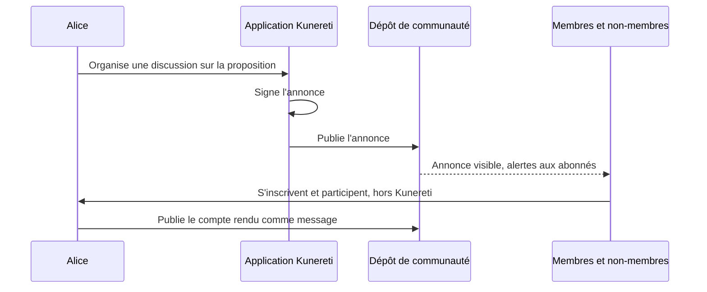

# **Organiser un événement de discussion**

## Résumé
Alice veut débattre de vive voix de la proposition sur les vélos. Elle annonce une réunion, attachée à la proposition : date, lieu ou lien de visioconférence, langue. L'événement est visible des non-membres, ce qui en fait aussi un moyen de faire connaître la communauté. Kunereti annonce ; il ne tient pas les agendas et n'héberge pas la réunion.

## Acteurs en jeu
- **Alice** : l'organisatrice.
- **Application Kunereti**.
- **Dépôt de communauté** : porte l'annonce.
- **Membres et non-membres** : les invités.

## Prérequis
- Alice est membre et n'a pas atteint le nombre maximal d'événements à venir par membre, fixé par la charte.
- Le contenu concerné est publié.

## Étapes du scénario
1. Alice ouvre la proposition et choisit « Organiser une discussion ».
2. Elle saisit la date, l'heure et le fuseau horaire, la langue, le lieu ou le lien de connexion, et la façon de s'inscrire.
3. L'application crée une annonce signée, qui cite la proposition et en reprend les thèmes.
4. L'annonce est publiée dans la partie publique du dépôt de communauté : un non-membre peut la lire.
5. Les membres abonnés à la proposition, ou dont un centre d'intérêt y répond, sont alertés.
6. La réunion a lieu, hors de Kunereti.
7. Alice, ou un autre participant, en publie le compte rendu comme message sur la proposition : ce qui s'est dit de vive voix n'entre dans la délibération que par là.
8. Si la proposition est masquée ou retirée, l'annonce l'est aussi.

## Diagramme de séquence Mermaid

Ce diagramme illustre une fonction ajoutée à KuneAgi en 2018. Elle rappelle que la délibération ne se réduit pas à l'écrit asynchrone, et pose une règle simple : la parole ne compte que rapportée, par un message signé.

Cas d'utilisation : « Discuter ». Retour à l'analyse : [[KR Analyse]].
