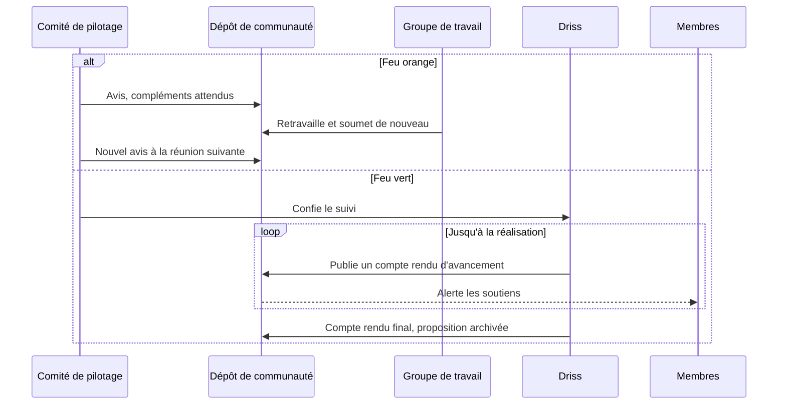

# **Suivre la mise en œuvre d'une proposition adoptée**

## Résumé
Un avis favorable n'est pas une réalisation. Après son feu vert, le comité de pilotage rend compte de la mise en œuvre de la proposition sur les vélos. Et quand il n'a pas pu trancher, la proposition reste à l'étude : le groupe peut la retravailler jusqu'à la réunion suivante du comité.

## Acteurs en jeu
- **Driss** : membre du comité, chargé du suivi.
- **Le groupe de travail** de la proposition.
- **Dépôt de communauté**.
- **Les membres**.

## Prérequis
- Le comité a examiné la proposition (scénario 31).
- La charte dit à quelle fréquence le comité se réunit.

## Étapes du scénario
1. Premier cas : le comité rend un feu orange. Il lui manque un chiffrage. La proposition reste à l'état « à l'étude » et l'avis dit ce qui est attendu.
2. Le groupe de travail rouvre une itération, complète le texte et le soumet de nouveau avant la réunion suivante du comité. Les jetons restent en place.
3. À la réunion suivante, le comité rend un feu vert (scénario 31).
4. Second cas : la proposition est adoptée. Le comité désigne Driss pour en suivre la réalisation.
5. Driss publie des comptes rendus d'avancement : des messages signés qui citent la proposition, avec un état simple (décidé, en cours, réalisé, abandonné).
6. Les membres qui avaient soutenu la proposition en sont alertés.
7. Quand les vélos sont installés, Driss publie le compte rendu final ; la proposition passe à l'état archivé, avec son histoire complète.
8. Si la réalisation est abandonnée, le comité le dit et pourquoi ; un nouveau groupe peut reprendre la proposition.

## Diagramme de séquence Mermaid

Ce diagramme montre ce que les présentations de Nova-Ideo demandaient au comité : donner un avis visible de tous, puis communiquer l'avancement. Sans ce retour, les participants ne savent pas ce que devient leur travail, et la boîte à idées se vide.

Cas d'utilisation : « Soutenir et décider ». Retour à l'analyse : [[KR Analyse]].
