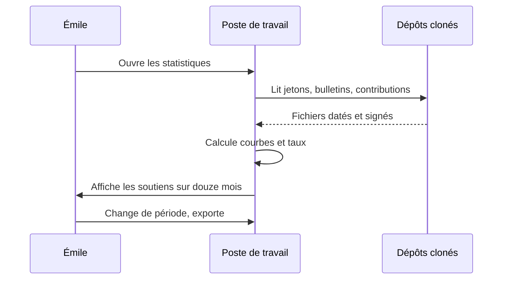

# **Consulter les statistiques des soutiens**

## Résumé
Avant la réunion du comité, Émile regarde comment les soutiens ont évolué. Il n'y a pas de tableau de bord tenu par un serveur : son application calcule les statistiques à partir des fichiers de jetons, de bulletins et de contributions qu'elle a synchronisés. Tout membre peut faire les mêmes calculs et doit trouver les mêmes chiffres.

## Acteurs en jeu
- **Émile** : le membre qui consulte.
- **Poste de travail**.
- **Dépôts clonés**.

## Prérequis
- Émile a synchronisé le dépôt de communauté.
- Les statistiques sont ouvertes à tous les membres.

## Étapes du scénario
1. Émile ouvre « Statistiques » sur son poste.
2. Le poste parcourt les fichiers de jetons, avec leurs poses et leurs retraits datés.
3. Il affiche, pour chaque proposition soumise, la courbe de ses soutiens et de ses oppositions.
4. Émile choisit la période : instantané, trois mois, douze mois. Sur douze mois, la proposition sur les vélos remonte en tête.
5. Il consulte la participation : nombre de contributions par appel, de participants par groupe, taux de participation aux scrutins.
6. Il consulte les échéances à venir : fins d'itération, clôtures de scrutins et d'appels.
7. Il exporte un tableau pour la réunion du comité.
8. Aucun de ces chiffres ne révèle plus que ce qui est déjà public dans les dépôts ; mais leur rapprochement peut en dire long sur un membre, même sous pseudonyme.

## Diagramme de séquence Mermaid

Ce diagramme illustre un calcul que chacun peut refaire. Il a un revers : les soutiens signés et datés d'un pseudonyme dessinent un profil. Publier les jetons en clair ou seulement leurs totaux est un choix que la charte doit faire.

Cas d'utilisation : « Soutenir et décider ». Retour à l'analyse : [[KR Analyse]].
