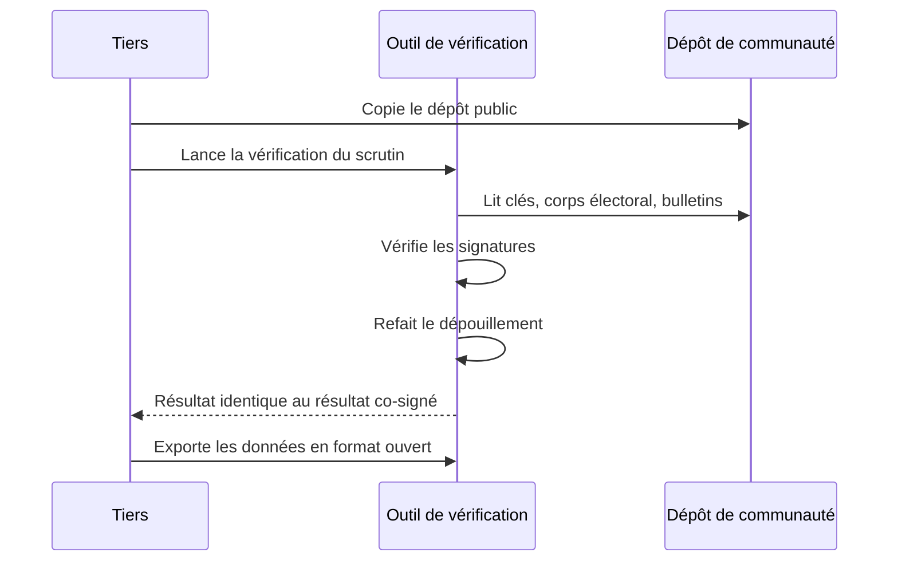

# **Faire vérifier un scrutin par un tiers**

## Résumé
Une journaliste veut vérifier que la charte des Tilleuls a bien été modifiée par le vote que la coopérative annonce. Elle n'est pas membre. Elle copie le dépôt public de la communauté, y lance les outils de vérification et refait le dépouillement. Elle n'apprend l'identité de personne : il n'y a que des pseudonymes.

## Acteurs en jeu
- **Un tiers** : journaliste, chercheur, autorité de contrôle.
- **Outil de vérification** : la ligne de commande de Kunereti, libre.
- **Dépôt de communauté**, dans sa partie publique.

## Prérequis
- La communauté a rendu public son dépôt, ou en remet une copie au tiers.
- Le scrutin est clos et dépouillé.
- Le tiers a installé l'outil de vérification.

## Étapes du scénario
1. Le tiers obtient l'adresse du dépôt et l'empreinte de la clé racine, par le QR code de la communauté.
2. Il copie le dépôt.
3. L'outil vérifie la chaîne de confiance : la clé racine, les autorités, les fiches de membres et leurs clés.
4. Il vérifie le scrutin : le corps électoral figé à l'ouverture, la signature de chaque bulletin, la liste figée à la clôture.
5. Il refait le dépouillement et compare son résultat au résultat co-signé.
6. Il vérifie que la modification de la charte correspond bien au texte soumis au vote, par son empreinte.
7. Le tiers exporte les données du scrutin dans un format ouvert : mentions par pseudonyme, médianes, classement.
8. Il peut attester ce qu'il a constaté. Il ne peut pas dire qui a voté quoi, seulement quel pseudonyme ; ni vérifier qu'un pseudonyme correspond à une seule personne, ce qui repose sur les attestations d'admission (scénario 3).

## Diagramme de séquence Mermaid

Ce diagramme montre la transparence que les spécifications de 2011 visaient en offrant le téléchargement de la base, et que KuneAgi a approchée en 2017 par l'export des justificatifs de scrutin. Elle est ici structurelle. Sa limite est celle de tout le système : on vérifie des signatures, pas des personnes.

Cas d'utilisation : « Garantir la confiance sans serveur ». Retour à l'analyse : [[KR Analyse]].
